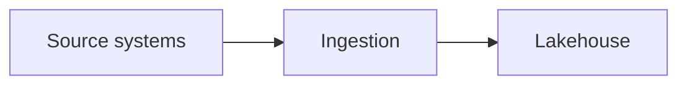

# Content guide

How to write lessons for Learning Hub. The validator (`python tools/validate.py`) enforces the format parts of this guide.

## Files

- Lessons live in `content/<track>/NN-module-name.md`, for example `content/fabric/01-fundamentals.md`.
- One module file holds 6 to 10 lessons. `NN` is the module number from the syllabus.
- Tracks: pyspark, fabric, databricks, snowflake, sql, python, ml, ai, tools.
- The plan for every track is in `syllabus/<track>.md` (format in `syllabus/_format.md`).

## Lesson format

Many lessons per file. Each lesson starts with a `# ` title line.

```
# Lesson title
id: <track>-m<NN>-<slug>
track: <track>
verified: YYYY-MM          (required for fabric, databricks, snowflake, tools, ai)

## What we're learning        (required)
## Benefit                    (required)
## Where it fits              (architecture position, neighbours; Mermaid welcome)
## Use case
## Code snippet               (only if useful)
## Sample data                (only if small and useful)
## Limits and misconceptions
## Compared with              (short table, only when alternatives matter)
## Remember this              (required, one sentence)
## Related                    (comma-separated lesson ids)
```

The parenthesised notes above are explanations, not part of the file. In a real lesson write `verified: 2026-10`.

### Parse rules

- A line starting with `# ` outside a code fence starts a lesson.
- `key: value` lines before the first `##` are metadata (`id`, `track`, `verified`).
- A line starting with `## ` outside a code fence starts a section.
- Section names must be from the list above, each at most once. Keep the order shown.
- Use `###` or lower inside a section if you need sub-headings.

### Ids

- Pattern: `<track>-m<NN>-<slug>`, slug in lowercase words joined by hyphens, e.g. `pyspark-m08-delta-merge`.
- The track must match the folder and `NN` must match the module file number.
- Ids come from the syllabus. Never rename or renumber an existing id.

### Related

- Comma-separated lesson ids, for example `pyspark-m08-delta-lake-overview, fabric-m02-lakehouse`.
- Every id must exist as a lesson or in a syllabus file. Unwritten (planned) ids show greyed out in the app.
- One home lesson per concept. Other tracks give their own platform view and link to the home lesson. Delta Lake's home is in pyspark.

## Writing and accuracy rules

1. Accuracy over fluency. Never invent features, version numbers, prices or product names. If you cannot confirm something, say so in the lesson or mark the title "(verify)".
2. fabric, databricks, snowflake, tools and ai lessons must be written from current sources found with web search or fetch, preferring official documentation. Set `verified` to the month you checked. Do not leave `verified: pending` in finished content.
3. Plain English, short sentences, no marketing wording. Explain the idea before the tool. State limits and when NOT to use the thing.
4. Each lesson is self-contained but ends with `Related` links to the home lesson of any concept it leans on, so concepts are explained once.
5. Mermaid: `flowchart LR` or `TD`, labels in double quotes. Add a diagram to "Where it fits" when it clarifies the architecture, not by default.
6. A lesson is typically 150 to 400 words plus optional snippet or table. Depth comes from correct, specific content and good connections, not length.
7. No practice tasks of any kind.

## Track-specific notes

- fabric, databricks, snowflake: concept-only, no code snippets.
- tools: concept-only, organised by role in the architecture. Each lesson says what the tool does, what it replaces or complements, and when to choose it.
- sql: T-SQL and Oracle are the primary dialects; add Spark SQL and Snowflake callouts where they differ.
- python: an ecosystem map, not a syntax tutorial.
- ml: module names carry stage labels ("Stage 0: Math and statistics"). Roadmap only, nothing is locked. Neural networks are a bridge; deep learning and transformers belong to ai.
- ai: never name specific model versions. Mark uncertain platform feature names with "(verify)".
- Code snippets only where a snippet clarifies the idea. Never force code.

## Mermaid example

````

````
