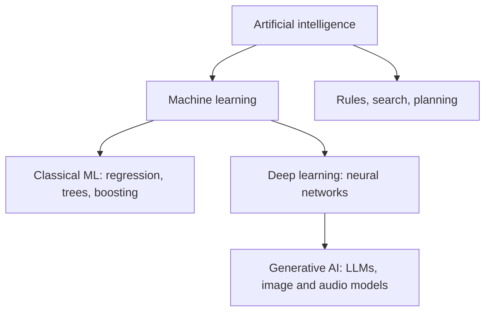

# AI vs ML vs deep learning vs generative AI
id: ai-m01-ai-ml-dl-genai
track: ai
verified: 2026-10

## What we're learning
The terms nest inside each other:

- **Artificial intelligence (AI)**: the broad goal of making computers perform tasks that seem to need intelligence. Includes rule-based systems, search and planning, and machine learning.
- **Machine learning (ML)**: systems that learn patterns from data instead of following hand-written rules. Includes classical models (regression, trees, boosting) covered in the ML track.
- **Deep learning (DL)**: machine learning with multi-layer neural networks that learn features from raw data (images, audio, text). Breakthroughs from around 2012 onward.
- **Generative AI (GenAI)**: models that **produce** new content (text, code, images, audio, video) rather than only classifying or predicting a number. **Large language models (LLMs)** are generative models trained on huge text corpora, usually transformers. **Foundation models** are large pretrained models adapted to many tasks.

## Benefit
Clear vocabulary keeps projects honest: a churn score needs ML, not an LLM; a contract summariser needs GenAI, not a gradient-boosted tree.

## Where it fits

## Limits and misconceptions
- "AI" in marketing often means any automation; ask what technique is actually used.
- Generative models are not automatically better than classical ML for structured prediction tasks; for tabular data they are usually worse and far more expensive.

## Remember this
AI contains ML, ML contains deep learning, and generative AI is deep learning that produces new content.

## Related
ml-m02-supervised-unsupervised, ai-m01-what-llms-can-cannot-do, ai-m03-attention-transformers

# What LLMs can and cannot do
id: ai-m01-what-llms-can-cannot-do
track: ai
verified: 2026-10

## What we're learning
Large language models generate text by predicting likely next tokens, after training on vast text and further tuning to follow instructions.

**Strong at**:
- Understanding and writing natural language: summarising, rewriting, translating, drafting.
- Extracting structure from unstructured text (invoices, emails, contracts) into JSON.
- Classifying and tagging text without training data, from instructions and a few examples.
- Writing and explaining code and SQL.
- Reasoning over information placed in their context, and calling tools when integrated with them.

**Weak or risky at**:
- **Facts not in the context**: they can **hallucinate** (produce confident, wrong statements), and their knowledge stops at a training cutoff.
- **Exact computation** and counting over large data: use code, SQL or tools.
- **Deterministic, auditable decisions**: outputs vary and are hard to explain; classical ML or rules are better for regulated scoring.
- **Very long or noisy contexts**: quality degrades as relevant information gets buried.
- **Adversarial input**: prompt injection can redirect them.

## Benefit
Matching tasks to strengths avoids the two common failures: using an LLM where SQL or a classifier would be cheaper and more reliable, and dismissing LLMs for language-heavy work they do very well.

## Limits and misconceptions
- Capabilities improve quickly; re-test tasks that failed a year ago.
- Fluent output is not evidence of correctness; verification must be designed in.

## Remember this
LLMs excel at language, extraction and code over provided context, and are unreliable for unsupported facts, exact computation and deterministic decisions.

## Related
ai-m08-hallucinations, ai-m05-rag-overview, ai-m04-tool-calling, ml-m02-problem-framing
