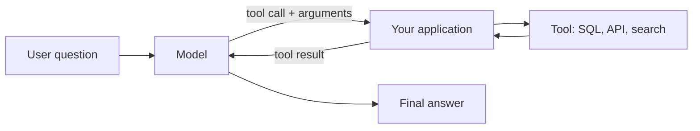

# Prompting
id: ai-m04-prompting
track: ai
verified: 2026-10

## What we're learning
A **prompt** is everything the model receives: a **system prompt** (role, rules, output format), the user's request, and any supplied context. Practices that consistently help:

- **Be specific**: state the task, audience, constraints and the exact output format.
- **Give context**: relevant data, definitions and why the task matters.
- **Show examples** (few-shot): two to five input-output pairs teach format and edge cases better than descriptions.
- **Structure the prompt**: separate instructions, context and input with clear delimiters (headings or tags), so the model does not confuse data with instructions.
- **Ask for reasoning when useful**: let the model work through complex problems (or use reasoning modes) before answering.
- **Break big tasks into steps** (prompt chaining) rather than one giant prompt.
- **Iterate with a test set**: change prompts against a fixed set of examples and measure, rather than judging by one output.

## Benefit
Good prompts are the cheapest lever on quality: often they remove the need for fine-tuning or a bigger model.

## Code snippet
```text
System: You classify IT support tickets for a data platform team.
Return only JSON: {"category": one of ["access", "pipeline_failure", "data_quality", "other"],
"urgency": "low" | "medium" | "high"}.
Urgency is high only if production reports or SLAs are affected.

<ticket>
Since 6am the finance dashboard shows yesterday's numbers; the nightly load failed.
</ticket>
```

## Limits and misconceptions
- Prompts are code: version them, test them, review changes.
- A prompt tuned for one model may behave differently on another or after a model upgrade; re-run evaluations.
- Instructions cannot fully protect against prompt injection in untrusted content.

## Remember this
Be specific, give context and examples, separate instructions from data, and measure prompt changes against a test set.

## Related
ai-m03-inference-parameters, ai-m04-structured-outputs, ai-m08-evals, ai-m08-prompt-injection


# Structured outputs
id: ai-m04-structured-outputs
track: ai
verified: 2026-10

## What we're learning
Data pipelines need machine-readable output, not prose. **Structured outputs** make a model return JSON that matches a **JSON Schema** you provide. Major providers enforce this with **constrained decoding**: the schema is compiled into a grammar, and at each step tokens that would break the schema are masked out, so the output always parses and matches. A related feature, **strict tool calling**, guarantees tool names and argument shapes.

Libraries such as Pydantic generate the schema from typed classes and validate the result in code.

## Benefit
Extraction and classification at scale (invoices to fields, tickets to categories, contracts to clauses) become reliable pipeline steps with no fragile parsing of free text.

## Code snippet
```python
from pydantic import BaseModel
from typing import Literal

class Invoice(BaseModel):
    supplier: str
    invoice_number: str
    total: float
    currency: Literal["EUR", "USD", "GBP"]

schema = Invoice.model_json_schema()      # send as the response schema to the model API
# ... call the model with structured output enabled ...
invoice = Invoice.model_validate_json(response_text)   # still validate in code
```

## Limits and misconceptions
- **Valid JSON is not correct data**: the schema guarantees shape, not truth. Validate business rules and sample-check accuracy.
- Exceptions to the guarantee: refusals, and outputs cut off by the max-token limit.
- Providers support a subset of JSON Schema (often requiring all fields and no additional properties; limited numeric or regex constraints); complex schemas may be rejected or slow on first use.
- Missing information should be modelled explicitly (nullable fields), or the model may invent values.

## Remember this
Structured outputs guarantee schema-valid JSON via constrained decoding; still validate values and allow nulls for missing information.

## Related
ai-m09-llm-extraction, python-m01-classes-dataclasses, ai-m04-tool-calling


# Tool and function calling
id: ai-m04-tool-calling
track: ai
verified: 2026-10

## What we're learning
**Tool calling** (function calling) lets a model use your code. You describe tools to the model (name, description, JSON Schema of parameters). When the model decides a tool would help, it returns a **tool call** with arguments instead of a final answer. **Your application** executes the tool (run a SQL query, call an API, look up a customer), sends the result back, and the model continues, possibly calling more tools, until it answers.

The model never executes anything itself; your code is in control of what runs and with what permissions.

## Benefit
Tools give models live data, exact computation and the ability to act, which addresses their weaknesses (stale knowledge, arithmetic, no access to systems). Tool calling is the foundation of agents and of the Model Context Protocol.

## Where it fits


## Limits and misconceptions
- Tool descriptions are prompts: clear names, descriptions and parameter documentation decide whether the model picks the right tool.
- Every tool is an attack surface: validate arguments, enforce least privilege, and require human approval for consequential actions.
- Tool results are untrusted input to the model (they can contain injected instructions).
- Too many tools confuse models and cost tokens; group or route them.

## Remember this
With tool calling, the model proposes a function call and your code runs it and returns the result; you control permissions.

## Related
ai-m06-tool-using-agents, ai-m06-mcp, ai-m08-prompt-injection, ai-m04-structured-outputs


# Cost and latency
id: ai-m04-cost-latency
track: ai
verified: 2026-10

## What we're learning
LLM cost is mostly **tokens**: price per million input tokens plus (usually higher) price per million output tokens, including hidden reasoning tokens. **Latency** has two parts: **time to first token** (grows with input size) and generation time (grows with output length).

Levers, roughly in order of impact:
- **Choose the right model size**: small models handle classification and extraction well at a fraction of the cost; route only hard cases to large models.
- **Prompt caching**: providers discount repeated, identical prompt prefixes (often around 90 percent off cached input), so put static instructions and documents first.
- **Batch APIs**: asynchronous processing at around half price for jobs that can wait up to a day.
- **Trim context**: retrieve fewer, better passages; summarise history.
- **Limit output**: concise formats, `max_tokens`, structured outputs.
- **Control reasoning effort** for simple tasks.
- **Streaming** improves perceived latency for users.
- **Response caching** for exact repeated questions (semantic caching with care).

## Benefit
The same application can differ in cost by an order of magnitude depending on these choices, which decides whether a use case is economically viable at scale.

## Limits and misconceptions
- Per-token prices fall quickly, but usage tends to grow faster; budgets and monitoring are still needed.
- Cheaper models need evaluation on your task; quality differences can be large.
- Prices, cache durations and discounts change; check provider pages.

## Remember this
Cost and latency scale with tokens; right-size the model, cache static prompt prefixes, batch what can wait, and trim context and output.

## Related
ai-m10-cost-control, ai-m10-caching, ai-m03-tokenization, ai-m07-distillation
