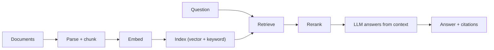

# RAG: retrieval-augmented generation
id: ai-m05-rag-overview
track: ai
verified: 2026-10

## What we're learning
**Retrieval-augmented generation (RAG)** answers questions using your own documents. Instead of relying on what the model memorised, the application **retrieves** relevant passages and puts them into the prompt, and the model answers **from that context**, ideally with citations.

Two pipelines:
1. **Indexing** (offline): collect documents, parse them, split into **chunks**, compute **embeddings**, store chunks with metadata in a **search index** (vector, keyword or both).
2. **Querying** (online): take the question (optionally rewrite it), retrieve candidate chunks, **rerank** them, build a prompt with the best chunks and instructions, generate the answer with citations, and apply checks.

## Benefit
RAG gives current, organisation-specific answers with sources, without retraining a model, and permissions can be applied at retrieval time.

## Where it fits

## Limits and misconceptions
- **Retrieval quality is the main bottleneck**: if the right passage is not retrieved, the model cannot answer correctly (and may guess).
- RAG reduces but does not eliminate hallucination.
- For small, stable knowledge bases, putting everything in a long prompt with caching can be simpler.
- **RAG versus fine-tuning**: use RAG to add knowledge and fine-tuning to change behaviour or format.
- Document-level permissions must be enforced in retrieval; otherwise users can see content they should not.

## Remember this
RAG retrieves relevant chunks of your documents into the prompt so the model answers from them with citations; retrieval quality decides answer quality.

## Related
ai-m11-rag-internal-docs, ai-m05-chunking, ai-m05-vector-search, ai-m07-when-not-to-fine-tune

# Chunking and document preparation
id: ai-m05-chunking
track: ai
verified: 2026-10

## What we're learning
Before retrieval, documents must be **parsed** and **chunked**:

- **Parsing**: extract clean text and structure from PDFs, Word, HTML, slides and scans: headings, tables, lists, page numbers. Layout-aware parsers and OCR (or multimodal models) matter for tables and scanned documents.
- **Chunking strategies**:
  - Fixed-size chunks (a few hundred tokens) with some overlap (10 to 20 percent): simple starting point.
  - Structure-aware chunks that follow headings, sections, paragraphs, code blocks and tables.
  - Semantic chunking that splits where topics change.
  - Parent-child (small-to-big): retrieve small precise chunks but pass their larger parent section to the model.
- **Metadata**: document title, section path, date, owner, source system, access groups; used for filtering and citations.
- **Contextual enrichment**: prepend a short, model-generated description of where the chunk sits in the document (a technique Anthropic called **contextual retrieval**) so chunks like "Revenue grew 3 percent" keep their context; reported to cut retrieval failures substantially.

## Benefit
Most RAG quality problems are fixed here: good parsing and chunking make the right passage findable and self-explanatory.

## Limits and misconceptions
- There is no universally best chunk size; evaluate with your questions.
- Tables split across chunks lose meaning; keep them whole or convert to text summaries.
- Re-chunking or re-embedding the corpus is a pipeline job; design it to be repeatable and incremental.

## Remember this
Parse documents carefully, chunk along their structure, attach rich metadata, and add context to chunks so each can stand alone.

## Related
ai-m09-unstructured-pipelines, ai-m05-rag-evaluation, ai-m03-embeddings

# Vector search and indexes
id: ai-m05-vector-search
track: ai
verified: 2026-10

## What we're learning
**Vector search** finds the chunks whose embeddings are nearest to the query's embedding. Exact search compares against every vector, which is too slow for large collections, so systems use **approximate nearest neighbour (ANN)** indexes:

- **HNSW**: a layered graph; fast and accurate, memory-hungry; the most common default.
- **IVF**: clusters vectors and searches the closest clusters; tunable speed-recall trade-off.
- **DiskANN**-style graph indexes on SSD for billion-scale collections.
- **Quantisation** compresses vectors to save memory at some accuracy cost.

**Metadata filtering** (by department, date, document type, user permissions) is applied before or during search. Recall (did we find the true nearest neighbours?) is the key quality metric for the index itself.

Vector search is offered by dedicated vector databases and by most data platforms and databases (Databricks, Snowflake Cortex Search, Fabric, PostgreSQL with pgvector, Azure AI Search, Elasticsearch).

## Benefit
Vector search finds passages that match the **meaning** of a question even when they use different words, which keyword search misses.

## Limits and misconceptions
- Pure vector search misses exact terms (product codes, error numbers, names); combine with keyword search.
- Restrictive filters can reduce recall in some ANN implementations; test filtered queries.
- Changing the embedding model requires rebuilding the index.

## Remember this
Vector search uses approximate indexes such as HNSW to find semantically similar chunks fast, with metadata filters for scope and permissions.

## Related
tools-m10-vector-databases, ai-m05-hybrid-search, ai-m03-embeddings, databricks-m06-vector-search

# Hybrid search
id: ai-m05-hybrid-search
track: ai
verified: 2026-10

## What we're learning
**Hybrid search** runs two retrievers and merges their results:

- **Keyword (lexical) search**, typically **BM25**: scores documents by matching terms, weighted by rarity. Excellent for exact identifiers, names, codes, acronyms and rare words.
- **Vector (semantic) search**: matches meaning and paraphrases.

Results are combined, most often with **reciprocal rank fusion (RRF)**: each document's fused score is the sum over retrievers of 1 / (k + its rank), with k commonly 60. RRF needs no score normalisation and is robust. Weighted score blending is an alternative.

## Benefit
Hybrid search consistently retrieves better than either method alone in enterprise content full of product codes, ticket numbers, table names and jargon.

## Limits and misconceptions
- Two indexes to build and keep in sync.
- Fusion weights or k may need tuning for your data, measured with retrieval metrics.
- Hybrid retrieval is usually followed by a reranker for the final ordering.

## Remember this
Combine BM25 keyword search with vector search, merge with reciprocal rank fusion, and you catch both exact terms and meaning.

## Related
ai-m05-vector-search, ai-m05-reranking, tools-m10-vector-databases

# Reranking
id: ai-m05-reranking
track: ai
verified: 2026-10

## What we're learning
Retrievers are built for speed: they encode query and documents separately (a **bi-encoder**) and compare vectors. A **reranker** is a slower, more accurate second stage that looks at the **query and each candidate together** (a **cross-encoder**, or an LLM used as a judge of relevance) and produces a relevance score.

Typical pipeline: retrieve 50 to 150 candidates with hybrid search, rerank, and pass the top 5 to 20 to the generator. Rerankers are available as APIs, open models and built-in features of search platforms.

## Benefit
Reranking often gives the largest single quality gain after good chunking, because it puts the truly relevant passages at the top of a limited context.

## Limits and misconceptions
- Adds latency and cost per query; limit the candidate count.
- A reranker cannot recover passages that were never retrieved; first-stage recall still matters.
- Domain-specific language may need rerankers evaluated (or fine-tuned) on your data.

## Remember this
Retrieve broadly and cheaply, then rerank candidates with a cross-encoder so the best passages reach the model.

## Related
ai-m05-hybrid-search, ai-m05-rag-evaluation

# Evaluating RAG
id: ai-m05-rag-evaluation
track: ai
verified: 2026-10

## What we're learning
Evaluate the two halves of RAG separately and together:

**Retrieval**
- **Recall at k**: is a relevant chunk among the top k?
- **Precision**, **MRR** and **NDCG**: are relevant chunks ranked high?
- Needs a test set of questions with known relevant documents.

**Generation**
- **Faithfulness (groundedness)**: is every claim supported by the retrieved context?
- **Answer relevance**: does it address the question?
- **Correctness** against reference answers where available.
- **Citation accuracy**: do cited sources support the claims?

Frameworks such as **RAGAS** (faithfulness, response relevancy, context precision and context recall), DeepEval and platform evaluation tools (MLflow, Azure, Databricks) compute these, mostly using an **LLM as judge**, supplemented by human review.

## Benefit
A fixed evaluation set turns RAG tuning (chunk size, retriever, reranker, prompt, model) from guesswork into measurable comparisons, and catches regressions after changes.

## Limits and misconceptions
- LLM judges have biases (favouring long answers, their own outputs, position); calibrate against human labels.
- Synthetic test questions generated from documents are easier than real user questions; collect real ones from logs.
- Good offline scores do not guarantee user satisfaction; monitor feedback in production.

## Remember this
Measure retrieval (recall, ranking) and generation (faithfulness, relevance, correctness) on a fixed question set, using LLM judges checked against humans.

## Related
ai-m08-evals, ai-m05-reranking, ai-m10-monitoring
