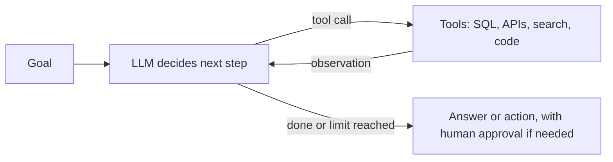

# Tool-using agents
id: ai-m06-tool-using-agents
track: ai
verified: 2026-10

## What we're learning
An **agent** is an LLM that runs in a **loop**, deciding its own next step: it reads the goal and context, chooses a tool to call (or answers), observes the tool result, and repeats until it decides the task is done or a limit is reached.

A useful distinction (from Anthropic's widely cited guidance):
- **Workflows**: LLM calls and tools arranged in **predefined** code paths: prompt chaining, routing, parallelisation, orchestrator-workers, evaluator-optimizer loops.
- **Agents**: the model **dynamically** directs its own process and tool use, for open-ended tasks where the steps cannot be predicted.

The building block of both is an "augmented LLM": a model with retrieval, tools and memory.

## Benefit
Agents can handle multi-step tasks (investigate a failed pipeline: read logs, query metadata, check recent changes, summarise) that a single prompt cannot.

## Where it fits

## Limits and misconceptions
- **Start simple**: a single well-prompted call or a fixed workflow is cheaper, faster and more predictable; add agentic autonomy only when it measurably helps.
- Agents cost more (many calls) and errors compound over steps.
- Good **tool design** (clear names, documentation, narrow scope, helpful errors) matters as much as the model.
- Stopping conditions, step limits and budgets are essential.

## Remember this
An agent loops: decide, call a tool, observe, repeat; prefer simple workflows unless the task truly needs dynamic steps.

## Related
ai-m04-tool-calling, ai-m06-failure-modes, ai-m06-planning, databricks-m06-agent-tooling

# Planning and reasoning patterns
id: ai-m06-planning
track: ai
verified: 2026-10

## What we're learning
Common patterns for structuring how an LLM system works through a task:

- **Prompt chaining**: fixed sequence of steps, each output feeding the next, with checks between.
- **Routing**: classify the input first, then send it to a specialised prompt, tool set or model.
- **Plan-then-execute**: the model writes a plan (list of steps), then executes them, revising if results differ.
- **ReAct-style loops**: interleave reasoning and tool actions step by step.
- **Orchestrator-workers**: a central model splits a task dynamically and delegates sub-tasks, then synthesises.
- **Evaluator-optimizer (reflection)**: one call generates, another critiques against criteria, and the first revises.
- **Parallelisation**: split independent sections, or ask several times and vote.

Modern models with built-in reasoning modes do much of the step-by-step thinking internally, so explicit scaffolding is often lighter than in earlier designs.

## Benefit
Choosing the simplest pattern that fits makes systems more reliable, debuggable and cheaper than open-ended autonomy.

## Limits and misconceptions
- Every extra step adds latency and cost; measure whether reflection or planning improves results.
- Plans written by models can be confidently wrong; validate key steps with tools or rules.
- Visible reasoning is not a faithful explanation of how the model reached an answer.

## Remember this
Use chaining, routing, planning, orchestrator-worker and critique patterns deliberately, choosing the simplest that measurably works.

## Related
ai-m06-tool-using-agents, ai-m06-multi-agent, ai-m03-inference-parameters

# Agent memory
id: ai-m06-memory
track: ai
verified: 2026-10

## What we're learning
LLMs are stateless: each call sees only its context. **Memory** gives agents continuity:

- **Short-term (working) memory**: the conversation and tool results in the current context window. Managed by trimming, summarising ("compaction") and dropping old tool outputs.
- **Long-term memory**: facts, preferences and past outcomes stored outside the model (a database, a vector store, structured notes or files) and retrieved when relevant.
- **Episodic memory**: records of past runs (what was tried, what worked) to improve future runs.
- **Shared state** in multi-step workflows: a task record or scratchpad the orchestration code maintains.

## Benefit
Memory lets assistants remember user preferences, continue long tasks across sessions, and avoid repeating failed approaches.

## Limits and misconceptions
- Memory is a data store with personal and sensitive data: apply retention, access control and deletion rights.
- Retrieved memories can be stale or wrong, and can be poisoned by injected content; validate what gets written.
- More memory in context is not always better; irrelevant memories distract the model.

## Remember this
Agents keep short-term memory in the context window and long-term memory in external stores, retrieved selectively and governed like data.

## Related
ai-m03-context-windows, ai-m05-rag-overview, ai-m08-privacy

# Model Context Protocol
id: ai-m06-mcp
track: ai
verified: 2026-10

## What we're learning
The **Model Context Protocol (MCP)** is an open standard for connecting AI applications to tools and data. Created by Anthropic in 2024, it was donated in December 2025 to the **Agentic AI Foundation** under the Linux Foundation, and is supported across major AI vendors and developer tools.

Architecture:
- A **host** (an AI application or IDE) runs **clients**, each connected to an **MCP server**.
- Servers expose **tools** (actions the model can call), **resources** (data addressed by URI) and **prompts** (reusable templates).
- Messages use JSON-RPC over **stdio** (local servers) or **Streamable HTTP** (remote servers), with **OAuth 2.1**-based authorisation for remote servers.
- The specification is versioned by date; the July 2026 revision moved to a more **stateless** design (no protocol sessions), simplifying scaling of remote servers.

A companion standard, **Agent2Agent (A2A)**, handles agent-to-agent communication; MCP connects agents to tools and data.

## Benefit
Write a connector once (for a database, a catalog, a ticketing system) and any MCP-capable assistant can use it, instead of building integrations per application. Data platforms now ship MCP servers for their catalogs and SQL engines.

## Limits and misconceptions
- MCP standardises the connection, not the security: servers can expose powerful actions, tool descriptions can be malicious, and tool results can carry prompt injection. Review servers, apply least privilege, and require approval for risky tools.
- Official security guidance warns about token passthrough, confused-deputy problems with OAuth proxies, and running untrusted local servers.
- Too many connected tools degrade model choices and cost tokens.

## Remember this
MCP is the open standard for plugging tools and data into AI applications through servers; it standardises connections, not trust.

## Related
ai-m04-tool-calling, ai-m08-prompt-injection, ai-m06-tool-using-agents, ai-m10-gateways

# Multi-agent patterns
id: ai-m06-multi-agent
track: ai
verified: 2026-10

## What we're learning
**Multi-agent systems** split work across several LLM agents with different roles, prompts or tools:

- **Manager (orchestrator-worker)**: a central agent delegates sub-tasks to specialist agents (treated as tools) and combines results. Control stays central.
- **Handoffs (decentralised)**: agents pass control to each other (a triage agent hands a billing question to the billing agent).
- **Parallel specialists**: several agents research different aspects simultaneously, then a synthesiser merges.
- **Debate or review**: one agent proposes, another critiques.

Protocols such as **A2A (Agent2Agent)**, now under the Linux Foundation's Agentic AI Foundation with a stable 1.0 specification in 2026, let agents from different systems discover each other and delegate tasks.

## Benefit
Separating roles keeps each agent's context and tool set small and focused, which can improve reliability on broad tasks and lets teams own their own agents.

## Limits and misconceptions
- Provider guidance converges on: **start with a single agent** and move to multiple only when a single agent's instructions or tools become unmanageable.
- More agents mean more calls, cost, latency and failure points; coordination errors are hard to debug.
- Tracing every agent step is essential.

## Remember this
Use multiple agents (manager or handoff patterns) only when one agent cannot cope; they add cost and coordination risk.

## Related
ai-m06-planning, ai-m06-failure-modes, ai-m10-monitoring

# Agent failure modes
id: ai-m06-failure-modes
track: ai
verified: 2026-10

## What we're learning
Typical ways agents go wrong:

- **Loops**: repeating the same tool call or plan without progress.
- **Wrong tool or wrong arguments**: plausible but incorrect calls, such as querying the wrong table.
- **Compounding errors**: an early mistake propagates through later steps.
- **Hallucinated results**: claiming success or inventing tool outputs.
- **Goal drift**: wandering from the original task.
- **Excessive agency**: taking actions beyond what was intended (deleting, sending, spending).
- **Prompt injection** through retrieved documents, emails, web pages or tool results.
- **Cost and latency blowups** from long loops and large contexts.

Containment:
- Step limits, timeouts and token budgets.
- Least-privilege tools; read-only by default; **human approval** for irreversible actions.
- Validation of tool arguments and outputs in code.
- Full **tracing** of every step, and evaluation on realistic test scenarios before release.
- Sandboxed execution for code and browsing.

## Benefit
Designing for failure up front is what makes agents safe enough to connect to real systems.

## Limits and misconceptions
- Better models reduce but do not remove these failures.
- "The model will ask before doing something risky" is not a control; enforce it in code.

## Remember this
Agents loop, misuse tools, compound errors and can be hijacked; bound them with limits, least privilege, approvals, validation and tracing.

## Related
ai-m08-guardrails, ai-m08-prompt-injection, ai-m10-monitoring, ai-m06-tool-using-agents
