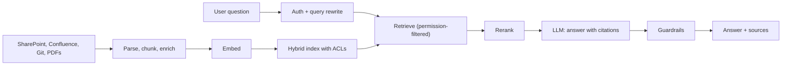
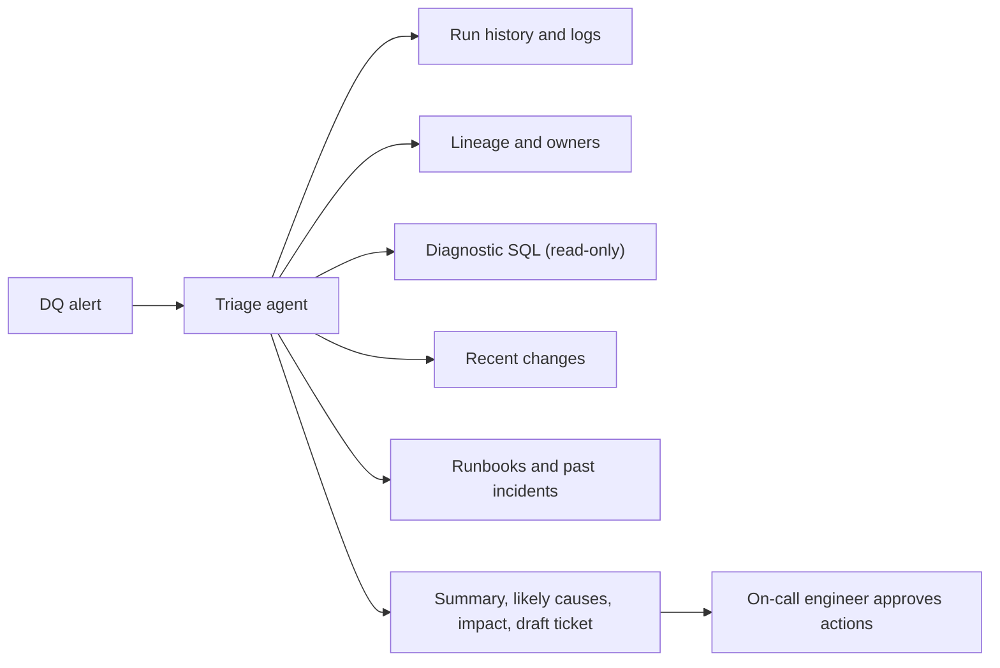

# Reference: RAG over internal documentation
id: ai-m11-rag-internal-docs
track: ai
verified: 2026-10

## What we're learning
A reference design for an assistant that answers questions from internal documentation (policies, runbooks, data platform docs, wikis):

**Ingestion pipeline** (scheduled or event-driven, incremental):
1. Connectors read SharePoint, Confluence, Git repos, PDFs; capture metadata and **access control lists**.
2. Parse (layout-aware for PDFs and tables), chunk along structure, add context and metadata.
3. Embed chunks; index in a **hybrid** index (vector plus keyword) with metadata and permissions; propagate updates and deletes.

**Query path**:
1. Authenticate the user; rewrite the question if needed (resolve follow-ups).
2. Hybrid retrieval **filtered by the user's permissions**; rerank; select top passages.
3. Prompt the model with instructions to answer **only from the passages**, cite sources, and say when the answer is not found.
4. Output guardrails (PII, groundedness check); return answer with links.

**Operations**: evaluation set of real questions, tracing, feedback buttons, cost tracking, owners for content freshness.

## Benefit
Employees find answers in seconds with sources they can check, and the design scales across content sources with permissions intact.

## Where it fits

## Limits and misconceptions
- Outdated or contradictory documents produce outdated answers; content ownership matters more than model choice.
- Permission sync lag can expose newly restricted documents; design for timely updates.
- Measure retrieval and answer quality separately.

## Remember this
Ingest incrementally with permissions, retrieve hybrid and permission-filtered, rerank, answer only from cited passages, and evaluate continuously.

## Related
ai-m05-rag-overview, ai-m05-chunking, ai-m05-rag-evaluation, ai-m08-privacy

# Reference: a text-to-SQL assistant
id: ai-m11-text-to-sql-assistant
track: ai
verified: 2026-10

## What we're learning
A reference design for answering business questions over a warehouse or lakehouse:

1. **Semantic foundation**: curated, documented tables or a semantic layer (metric views, semantic views, semantic models, dbt metrics) defining metrics, dimensions and approved joins. This is the most important component.
2. **Context retrieval**: for each question, retrieve relevant metrics, tables, column descriptions, sample values, business glossary terms and **verified example queries**.
3. **Generation**: the model produces SQL (or a query against the semantic layer) plus an explanation of the definitions used; it asks a clarifying question when terms are ambiguous ("revenue gross or net?").
4. **Validation and execution**: parse and lint the SQL, enforce **read-only** access and row limits, run it **as the user** (so row-level security applies), catch errors and let the model retry.
5. **Answer**: a table or chart, the SQL, the definitions and data freshness, with feedback buttons.
6. **Improvement loop**: benchmark questions with expected results, reviewed failures added as examples, monitoring of accuracy and usage.

Platform implementations include Databricks Genie, Fabric data agents, Snowflake Cortex Analyst and BI tools' natural-language features.

## Benefit
Self-service answers on governed data, with definitions consistent with official reports.

## Limits and misconceptions
- Without a semantic layer, accuracy on real schemas is poor and inconsistent.
- Never give the assistant write access or broad service credentials.
- Users must be able to see and question the SQL and definitions.

## Remember this
Text-to-SQL needs a semantic layer, retrieved schema context and examples, read-only execution as the user, validation loops and a benchmark.

## Related
ai-m09-text-to-sql, tools-m08-semantic-layers, databricks-m05-genie, snowflake-m07-cortex

# Reference: an agent that triages data quality issues
id: ai-m11-dq-triage-agent
track: ai
verified: 2026-10

## What we're learning
A reference design for an agent that helps on-call data engineers with data quality incidents:

**Inputs**: alerts from data quality checks and observability tools (freshness, volume, schema, distribution), pipeline failures, and user reports.

**Tools (read-only by default)**:
- Query recent run history and logs (jobs, pipelines, orchestrator).
- Look up **lineage** (upstream sources, downstream reports) and **owners** from the catalog.
- Run small diagnostic SQL queries (row counts by day, null rates, distinct values) with limits.
- Check recent changes: Git commits, schema changes, deployment history.
- Search past incidents and runbooks (RAG).

**Behaviour**: summarise the issue, gather evidence, propose likely causes ranked with evidence, estimate impact (affected reports and users via lineage), draft a ticket and stakeholder message, and suggest remediation steps.

**Guardrails**: no write or reload actions without human approval; step and cost limits; all actions traced; sensitive data masked in context; clear handoff to the owner.

## Benefit
Cuts time from alert to diagnosis, gives consistent incident notes, and builds a searchable incident history.

## Where it fits

## Limits and misconceptions
- Causes suggested by the agent are hypotheses; verify before acting.
- Quality depends on metadata: lineage, ownership and run logs must exist and be accessible.
- Start as an assistant that drafts; consider automated actions only for well-understood, reversible cases.

## Remember this
A DQ triage agent gathers evidence through read-only tools, proposes causes and impact, drafts the incident, and leaves fixes to humans.

## Related
ai-m09-dq-triage, tools-m07-data-observability, ai-m06-failure-modes, tools-m06-lineage
