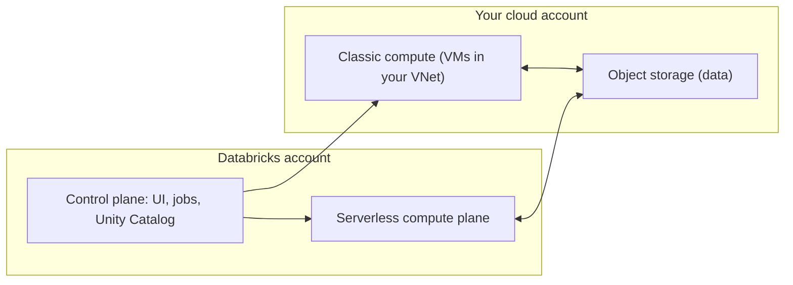

# Control plane and compute plane
id: databricks-m01-control-data-plane
track: databricks
verified: 2026-10

## What we're learning
Databricks splits its architecture in two:

- The **control plane** runs in Databricks' own cloud account: the web application, notebooks service, job scheduler, cluster manager, Unity Catalog services and APIs.
- The **compute plane** is where data is processed. It comes in two forms:
  - **Classic compute plane**: clusters run as virtual machines **in your own cloud account** and network (VPC or VNet). You pay Databricks for DBUs and your cloud provider for the VMs.
  - **Serverless compute plane**: compute runs **in Databricks' account**, in the same region as your workspace, isolated per workspace. Databricks manages capacity and the price includes the infrastructure.

Data itself lives in cloud object storage, usually in your account (or in fully managed default storage for serverless workspaces).

## Benefit
Understanding the split explains networking design (private links between your network and the control plane), security reviews (what data ever leaves your account), and the cost difference between classic and serverless.

## Where it fits

## Limits and misconceptions
- Serverless compute reaches your storage from Databricks' network; private connectivity to your sources needs network configuration (network connectivity configurations, private endpoints).
- The workspace storage bucket created for classic workspaces holds system data; do not modify or delete it.
- Control plane outages affect scheduling and UI even if your own cloud is healthy.

## Remember this
The control plane is Databricks' service; compute runs either in your account (classic) or in Databricks' account (serverless), while data stays in object storage.

## Related
databricks-m01-accounts-workspaces, databricks-m01-compute-types, databricks-m08-serverless-vs-classic

# Accounts and workspaces
id: databricks-m01-accounts-workspaces
track: databricks
verified: 2026-10

## What we're learning
A Databricks **account** is the top level: it holds identities (users, groups, service principals), single sign-on, billing, Unity Catalog **metastores** (one per region) and **workspaces**. It is managed in the **account console**.

A **workspace** is the environment where people work: notebooks, jobs, pipelines, SQL warehouses, dashboards and compute. An account can have many workspaces (for example per environment or business unit), and a region's metastore can be attached to many workspaces, so they share one governed catalog.

**Identity federation** (on by default for new workspaces) means users and groups are defined once at account level and assigned to workspaces. Identities are synchronised from the identity provider through automatic identity management (Microsoft Entra ID, Okta) or SCIM.

## Benefit
Account-level identity and a shared metastore let you run separate workspaces for isolation while keeping one set of users, groups and data permissions.

## Limits and misconceptions
- Workspaces are not data boundaries by themselves: a shared metastore lets every attached workspace see catalogs unless you use workspace-catalog binding.
- Old workspace-local groups are not account groups; migrate them to keep permissions manageable.
- Limits apply to users, service principals and groups per account; large enterprises should plan group design early.

## Remember this
The account owns identity, billing and metastores; workspaces are where work happens, and many workspaces can share one governed metastore.

## Related
databricks-m02-unity-catalog-overview, databricks-m08-governance-patterns, databricks-m01-control-data-plane

# Compute types
id: databricks-m01-compute-types
track: databricks
verified: 2026-10

## What we're learning
Databricks offers several kinds of compute (names as of October 2026):

- **Serverless compute** for notebooks, jobs (Lakeflow Jobs) and pipelines: no cluster configuration, fast start, automatic scaling and upgrades, Photon always on.
- **Classic compute** (still called all-purpose and jobs compute in many docs): clusters you configure with node types, autoscaling, runtime version, libraries and init scripts. **Jobs compute** is created for a job run and terminated after it, at a lower price than interactive all-purpose clusters. **Instance pools** keep idle VMs ready to cut start time.
- **SQL warehouses** for SQL and BI: serverless, pro or classic.

Classic compute has an **access mode**:
- **Standard** (formerly shared): many users with isolation, uses Spark Connect; no RDD APIs, R or ML runtime.
- **Dedicated** (formerly single user): one user or group; supports R, ML runtime, GPUs and RDDs.
- **Auto**: chooses for you based on the runtime and node type.

## Benefit
Matching compute to the job (serverless for spiky interactive and scheduled work, jobs compute for heavy scheduled ETL, SQL warehouses for BI) is the biggest lever on cost and user experience.

## Limits and misconceptions
- Serverless restricts what you can configure: limited Spark settings, no init scripts, no R or Scala notebooks, no RDD API.
- Running scheduled jobs on interactive all-purpose clusters costs more than jobs compute.
- Standard access mode changes what code works (no `sparkContext`); test before moving from older shared or no-isolation clusters.

## Remember this
Use serverless where its limits are acceptable, jobs compute for configured scheduled work, SQL warehouses for BI, and pick access mode by isolation needs.

## Related
databricks-m08-serverless-vs-classic, pyspark-m10-managed-platforms, databricks-m05-sql-warehouses, pyspark-m14-spark-connect

# Databricks Runtime
id: databricks-m01-runtimes
track: databricks
verified: 2026-10

## What we're learning
The **Databricks Runtime (DBR)** is the software image on classic compute: Apache Spark plus Databricks improvements, Delta Lake, libraries and system packages. Versions in October 2026 include:

- **Runtime 19** (Spark 4.2), the latest.
- **18 LTS** (Spark 4.1), **17.3 LTS** (Spark 4.0), **16.4 LTS** (Spark 3.5) and older LTS versions still supported.

**LTS** (long-term support) versions are supported for about three years and are the right choice for production. **ML runtimes** add popular ML libraries (PyTorch, XGBoost, MLflow and others) and require dedicated access mode for Unity Catalog data. Serverless compute is "versionless": Databricks upgrades the runtime automatically, and you choose an **environment version** that pins Python and client libraries.

## Benefit
Pinning an LTS version on classic compute gives predictable behaviour and a long support window; serverless removes upgrade work in exchange for less control.

## Limits and misconceptions
- Major version jumps (Spark 3.5 to 4.x) bring behaviour changes such as ANSI mode by default; test pipelines before upgrading.
- A runtime's Spark version may include Databricks-only features or backports not in Apache Spark.
- Libraries installed on top of a runtime can conflict with bundled versions.

## Remember this
DBR packages Spark, Delta and libraries; pin LTS versions on classic compute and let serverless upgrade itself.

## Related
pyspark-m14-spark-4, databricks-m01-compute-types, databricks-m01-photon

# Photon
id: databricks-m01-photon
track: databricks
verified: 2026-10

## What we're learning
**Photon** is Databricks' native, vectorised query engine written in C++. It replaces parts of Spark's JVM execution for SQL and DataFrame operations, while Spark's Catalyst optimiser still plans the query. No code changes are needed.

Photon accelerates scans, filters, projections, aggregations, joins, shuffles, sorts, window functions and Delta and Parquet writes (including MERGE, UPDATE and DELETE). It is always on for serverless compute and SQL warehouses and can be enabled on classic compute. Unsupported operations fall back to the normal Spark engine automatically.

## Benefit
Large SQL and DataFrame ETL jobs and BI queries typically run noticeably faster, and some Databricks features (such as predictive I/O) depend on Photon.

## Limits and misconceptions
- Photon does not speed up Python UDFs, RDD code or very short queries.
- Stateful streaming is not accelerated.
- On classic compute, Photon uses a different (higher) DBU rate, so faster is not automatically cheaper; measure cost per job.

## Remember this
Photon is a C++ vectorised engine under Spark's planner that speeds up SQL and DataFrame work, but not UDFs, RDDs or stateful streaming.

## Related
pyspark-m07-catalyst-and-tungsten, fabric-m04-spark-performance-features, databricks-m07-dbu-cost-model
