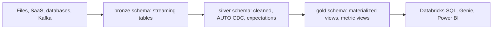

# Notebooks and the workspace
id: databricks-m03-notebooks
track: databricks
verified: 2026-10

## What we're learning
Databricks **notebooks** mix Python, SQL, Scala and R cells (by default one language per notebook, with magic commands to switch), run on attached compute, and show results, charts and Spark job progress inline. They support widgets for parameters, `%run` to include other notebooks, and **dbutils** utilities for files, secrets and notebook workflows. An AI assistant (renamed **Genie Code** in 2026) helps write and fix code.

**Git folders** (formerly Repos) connect workspace folders to a Git repository so notebooks and Python files can be branched, committed and reviewed. Plain `.py` and `.sql` files can live alongside notebooks and be imported as modules.

## Benefit
Notebooks make exploration and collaboration fast, and with Git folders the same files can move into versioned, reviewed production code.

## Limits and misconceptions
- Logic that lives only in notebook cells is hard to test and reuse; move shared code into Python modules or wheels and keep notebooks thin.
- `dbutils` and widgets are Databricks-specific; code using them does not run unchanged elsewhere.
- Interactive notebooks on all-purpose clusters are a common hidden cost when clusters are left running; use auto-termination or serverless.

## Remember this
Notebooks are for exploration and orchestration of steps; with Git folders they become versioned code, but shared logic belongs in modules.

## Related
python-m08-notebooks-vs-scripts, fabric-m04-notebooks, pyspark-m12-packaging-config

# Jobs (Lakeflow Jobs)
id: databricks-m03-jobs
track: databricks
verified: 2026-10

## What we're learning
**Lakeflow Jobs** (formerly Databricks Jobs, then Workflows) is Databricks' built-in orchestrator. A job is a graph of **tasks**: notebooks, Python scripts and wheels, JARs, SQL queries, dbt projects, declarative pipelines, other jobs, and more, with dependencies, **if/else** branches and **for-each** loops. Jobs run on serverless compute or job clusters, on a **schedule**, on **file arrival**, on **table updates**, or continuously, with retries, timeouts, parameters, notifications and repair runs (rerun only failed tasks).

## Benefit
For work that lives mainly on Databricks, Lakeflow Jobs removes the need for a separate orchestrator, and it understands Databricks compute, Unity Catalog tables and pipelines natively.

## Limits and misconceptions
- Cross-platform workflows (an on-premises extract, then Databricks, then a Power BI refresh) may still be easier in a general orchestrator, which can trigger Databricks jobs.
- Running job tasks on all-purpose interactive clusters costs more than job compute or serverless.
- Limits apply per workspace (tasks per job, concurrent runs); large estates should check them.

## Remember this
Lakeflow Jobs orchestrates multi-task workflows on Databricks with triggers, retries, branching and repair runs.

## Related
tools-m05-adf-fabric-pipelines, pyspark-m12-orchestration-airflow, databricks-m03-declarative-pipelines

# Declarative pipelines (formerly Delta Live Tables)
id: databricks-m03-declarative-pipelines
track: databricks
verified: 2026-10

## What we're learning
**Lakeflow Spark Declarative Pipelines** (the product formerly called **Delta Live Tables**, renamed in stages during 2025; Databricks pages also say "Spark Declarative Pipelines on Lakeflow") let you declare **what tables should contain**, and the system works out how to build and update them. The core declarative API was contributed to open-source Apache Spark as Spark Declarative Pipelines in Spark 4.1.

You define:
- **Streaming tables**: append-style incremental ingestion, each record processed once (often with Auto Loader or Kafka).
- **Materialized views**: query results kept up to date, refreshed incrementally where possible.
- **Flows**, including **AUTO CDC** (formerly APPLY CHANGES) to apply change feeds as SCD type 1 or type 2.
- **Expectations**: data quality rules with actions to warn, drop the row, or fail the update.

The system builds the dependency graph, manages checkpoints, retries, and table maintenance, and shows lineage and quality metrics per table.

## Benefit
Much less code for common ingestion and transformation patterns, with quality rules, CDC handling and orchestration built in.

## Limits and misconceptions
- Declarative means less control: custom streaming logic or unusual write patterns may not fit.
- Names changed several times; older code using `import dlt` still works, while new code uses `pyspark.pipelines`.
- Pipelines own their tables; editing them outside the pipeline can cause conflicts.

## Remember this
Declarative pipelines (formerly DLT) define streaming tables and materialized views with expectations and AUTO CDC, and Databricks runs the rest.

## Related
pyspark-m11-validation-expectations, snowflake-m02-dynamic-tables, pyspark-m08-scd-patterns, databricks-m03-auto-loader

# Auto Loader
id: databricks-m03-auto-loader
track: databricks
verified: 2026-10

## What we're learning
**Auto Loader** is Databricks' incremental file ingestion source (`cloudFiles`) for Structured Streaming and declarative pipelines. It discovers new files in cloud storage or volumes and loads each one exactly once, tracking progress in its checkpoint.

Key features:
- **Discovery**: directory listing (default) or **file notification / file events** for very large or busy directories (recommended at scale).
- **Schema inference**: samples files to infer a schema and stores it in a schema location; CSV and JSON columns are strings unless type inference is enabled.
- **Schema evolution modes**: add new columns (the stream stops and picks up the new schema on restart), rescue unexpected data into a `_rescued_data` column, fail on new columns, or ignore them.
- Schema hints to fix specific column types.

## Benefit
Robust, scalable ingestion of file drops (extracts, logs, partner files) with almost no code and with schema drift handled explicitly.

## Limits and misconceptions
- File order is not guaranteed; do not rely on processing order between files.
- Changed files with the same name are not reprocessed by default.
- It is Databricks-specific; the open-source alternative is the plain Structured Streaming file source.

## Remember this
Auto Loader loads new files exactly once with scalable discovery, schema inference and controlled schema evolution.

## Related
pyspark-m09-auto-loader, snowflake-m02-snowpipe, databricks-m02-volumes

# Managed ingestion connectors (Lakeflow Connect)
id: databricks-m03-ingestion-connectors
track: databricks
verified: 2026-10

## What we're learning
**Lakeflow Connect** provides managed connectors that ingest data into Unity Catalog tables without writing pipeline code:

- **SaaS connectors** such as Salesforce, Workday, ServiceNow, Google Analytics, Microsoft Dynamics 365, SharePoint, Google Drive and NetSuite (GA at various points in 2025 and 2026), with more in beta.
- **Database connectors** with CDC, such as SQL Server (GA), and MySQL and PostgreSQL (preview), using an ingestion gateway that reads changes and stages them.
- **Push ingestion** (Zerobus) for applications writing events directly into tables.

Connectors run on serverless compute and land data as streaming tables managed by declarative pipelines. **Lakeflow Designer** offers a no-code visual editor for building pipelines.

## Benefit
Common sources land in governed tables with incremental sync and CDC, without buying a separate connector product or maintaining API code.

## Limits and misconceptions
- Connector coverage is narrower than dedicated vendors such as Fivetran; check that your sources and features (deletes, history) are supported.
- Database CDC needs source configuration (CDC or change tracking enabled, network access to the gateway).
- Status varies per connector (GA, preview, beta); check before production use.

## Remember this
Lakeflow Connect is Databricks' managed ingestion for SaaS apps and databases, landing data as governed streaming tables.

## Related
tools-m01-managed-connectors, fabric-m03-copy-job, tools-m01-ingestion-styles

# Medallion architecture on Databricks
id: databricks-m03-medallion-on-databricks
track: databricks
verified: 2026-10

## What we're learning
On Databricks the medallion layers are usually mapped onto Unity Catalog and Lakeflow:

- **Catalogs** per environment (`dev`, `prod`) and sometimes per domain; **schemas** per layer (`bronze`, `silver`, `gold`), or catalogs per layer in larger estates.
- **Bronze**: streaming tables fed by Auto Loader, Lakeflow Connect or Kafka, append-only with ingestion metadata.
- **Silver**: streaming tables or materialized views with expectations, deduplication and AUTO CDC to apply changes.
- **Gold**: materialized views, metric views and aggregates for Databricks SQL, dashboards, Genie and external BI tools.
- **Governance**: grants per schema or catalog (engineers write bronze and silver, analysts read gold), ABAC tags for sensitive columns, lineage across layers.

## Benefit
Mapping layers onto catalogs and schemas gives each layer clear permissions and ownership, and declarative pipelines make layer-to-layer flows incremental and observable.

## Where it fits

## Limits and misconceptions
- The concepts are the same as the general medallion pattern; Databricks adds tooling, not a different idea.
- Separate catalogs per environment need workspace binding to stop dev workspaces from writing to prod data.

## Remember this
On Databricks, medallion layers become catalogs or schemas fed by declarative pipelines, with UC grants per layer.

## Related
pyspark-m08-medallion, databricks-m03-declarative-pipelines, databricks-m08-governance-patterns
