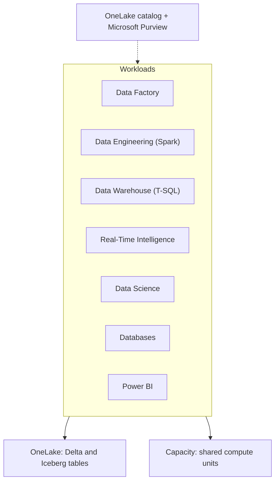
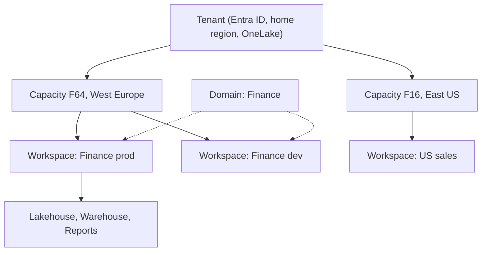

# What Microsoft Fabric is
id: fabric-m01-what-is-fabric
track: fabric
verified: 2026-10

## What we're learning
Microsoft Fabric is a **SaaS analytics platform**. Instead of provisioning separate Azure services for ingestion, Spark, a warehouse, streaming and BI, you get one service where all of these run on a shared compute pool (a **capacity**) and store their data in one shared lake (**OneLake**). You do not need an Azure subscription to use it, although capacities are bought through Azure.

Fabric groups its features into **workloads**. As of October 2026 Microsoft lists: Power BI, Databases, Data Factory, Data Engineering, Data Science, Data Warehouse, Real-Time Intelligence, Industry Solutions and a newer **Fabric IQ** workload (preview) for ontologies, graph and agents. Older docs call workloads "experiences".

Everything you build is an **item** in a **workspace**: a lakehouse, warehouse, notebook, pipeline, eventhouse, semantic model, report and so on. Items are the unit of permissions, Git source control and deployment.

## Benefit
One security model, one storage layer, one bill and one catalog across engineering, warehousing, streaming and BI. Data written by Spark is immediately readable by the SQL engine and Power BI without copying.

## Where it fits

## Limits and misconceptions
- SaaS means less control: you do not choose VM types for most engines, patch versions, or network topology the way you would with Azure Synapse or Databricks.
- "Unified" does not mean every engine supports every feature. The SQL analytics endpoint is read-only, Direct Lake has guardrails, and features reach GA at different times per workload.
- Fabric changes fast. Names, preview status and limits in this track were checked in October 2026 and should be rechecked for decisions.

## Remember this
Fabric is one SaaS platform where every workload shares a capacity for compute and OneLake for storage.

## Related
fabric-m01-onelake, fabric-m01-tenants-capacities-workspaces, fabric-m10-fabric-vs-databricks-vs-snowflake, fabric-m01-fabric-vs-synapse-adf-premium

# OneLake
id: fabric-m01-onelake
track: fabric
verified: 2026-10

## What we're learning
**OneLake** is the single logical data lake that comes with every Fabric tenant. There is exactly one per tenant: it is created automatically, cannot be deleted, and you cannot create a second one. It is built on Azure Data Lake Storage Gen2, so tools that speak the ADLS APIs can read and write it.

Its layout mirrors Fabric's hierarchy. In ADLS terms the account is always `onelake` and each **workspace is a container**; inside are items such as `Sales.Lakehouse`. Paths look like `abfss://<workspace>@onelake.dfs.fabric.microsoft.com/<item>.<itemtype>/Tables/...`. Workspace and item GUIDs can replace names, which avoids problems with spaces.

Tabular data is stored as **Delta Lake** tables, and OneLake can also present tables as **Apache Iceberg** (and Iceberg as Delta) through metadata virtualization.

## Benefit
"One copy of data": Spark, the SQL engine, KQL, and Power BI's Direct Lake mode all read the same Delta files. Shortcuts extend this to data that lives outside OneLake.

## Where it fits
OneLake sits under every Fabric workload. The **OneLake catalog** (with Explore, Govern and Secure tabs) is how people find and govern what is stored there; the older name "OneLake data hub" still appears in some places. The **OneLake file explorer** is a Windows app that shows OneLake like OneDrive.

## Limits and misconceptions
- One lake per tenant does not mean one region. Each workspace stores data in the region of its capacity.
- Use the regional endpoint (`https://<region>-onelake.dfs.fabric.microsoft.com`) when data residency matters; the global endpoint may route outside the region.
- Permissions and item management cannot be done through ADLS APIs; they are Fabric concepts.
- Soft delete keeps deleted files for 7 days. It is not a backup strategy.

## Remember this
OneLake is one ADLS-based lake per tenant, organised by workspace and item, holding Delta tables that every Fabric engine reads.

## Related
fabric-m02-shortcuts, pyspark-m08-delta-lake, tools-m03-object-storage, fabric-m02-delta-in-fabric, fabric-m08-onelake-security

# Tenants, capacities and workspaces
id: fabric-m01-tenants-capacities-workspaces
track: fabric
verified: 2026-10

## What we're learning
Fabric has a four-level containment hierarchy:

1. **Tenant**: your Microsoft Entra ID organisation. Tenant-wide settings and the single OneLake live here. The tenant has a **home region**.
2. **Capacity**: a pool of compute bought as an F SKU (or a legacy P SKU) in a specific **region**. A tenant can have many capacities, each billed separately.
3. **Workspace**: a collaboration container with members and roles, assigned to one capacity at a time. Every tenant also has a shared capacity that hosts "My workspace" and Pro or PPU workspaces.
4. **Item**: a lakehouse, warehouse, notebook, report and so on.

**Domains** sit beside this hierarchy: they group workspaces by business area for governance.

## Benefit
Separating capacities lets you isolate workloads (a production capacity that ad hoc users cannot slow down), place data in specific regions (Multi-Geo), and charge costs back to departments.

## Where it fits

## Limits and misconceptions
- A workspace's data lives in its capacity's region. Some metadata (permissions, report metadata, credentials) stays in the home region even with Multi-Geo.
- A workspace that contains non-Power BI Fabric items **cannot be moved to a capacity in another region**; those items must be removed first.
- When a capacity is paused, its workspaces' content is unavailable.
- Workspaces are the main boundary for roles, Git integration and deployment pipelines, so their design is a governance decision, not just folders.

## Remember this
Tenant holds settings and OneLake, capacities supply regional compute, workspaces hold items, and domains group workspaces for governance.

## Related
fabric-m01-licensing-capacity, fabric-m08-domains, fabric-m08-workspace-roles, fabric-m10-capacity-sizing-cost

# Licensing and capacity units
id: fabric-m01-licensing-capacity
track: fabric
verified: 2026-10

## What we're learning
Fabric is paid mainly through **capacities**. An F SKU gives a number of **capacity units (CU)** equal to its name: F2, F4, F8 up to F2048 and larger SKUs. Every operation (a Spark job, a warehouse query, a report render, a dataflow refresh) consumes CU-seconds from the capacity. F SKUs are billed per second through Azure with no commitment, can be **paused and resumed**, and can be discounted with 1- or 3-year **reservations** (compute only, not storage). Storage in OneLake is billed separately.

**Per-user licences** still matter for Power BI content:
- **Free**: can create and share non-Power BI items on a Fabric capacity.
- **Pro** or **PPU**: needed to author and share Power BI items.
- On **F64 and above**, viewers with a Free licence can view Power BI content; on **F2 to F32** every viewer needs Pro or PPU.

To keep short spikes from failing, Fabric uses **bursting** (run faster than the SKU allows) and **smoothing** (spread the cost over time: interactive operations over at least 5 minutes, background operations over 24 hours). If usage keeps exceeding the SKU, **throttling** applies in stages: interactive jobs are first delayed, then rejected, and finally background jobs are rejected too. Newer controls include **surge protection** and an opt-out **capacity overage** setting that bills excess use at a higher rate instead of throttling (on by default for new F capacities, as of the October 2026 docs).

## Benefit
One pool of compute for every workload, with predictable cost, and the ability to absorb spikes without sizing for the peak.

## Limits and misconceptions
- Smoothing hides overload until it suddenly throttles. One bad 24-hour background job can block interactive reports later in the day.
- Running operations are not stopped by throttling; new ones are delayed or rejected.
- Pausing a capacity bills the accumulated smoothed usage immediately.
- PPU does not give you a Fabric capacity.
- Exact prices vary by region; check the Azure pricing page rather than relying on remembered numbers.

## Remember this
You buy capacity units that every workload shares; bursting and smoothing absorb spikes, and sustained overuse leads to staged throttling.

## Related
fabric-m10-capacity-sizing-cost, fabric-m08-auditing-monitoring, databricks-m07-dbu-cost-model, snowflake-m01-credits

# Fabric vs Synapse, ADF and Power BI Premium
id: fabric-m01-fabric-vs-synapse-adf-premium
track: fabric
verified: 2026-10

## What we're learning
Fabric is Microsoft's successor platform for several earlier services:

- **Azure Synapse Analytics**: Fabric Data Warehouse, Fabric Spark, pipelines and Eventhouse cover the same ground as dedicated SQL pools, Synapse Spark, Synapse pipelines and Data Explorer. Synapse Data Explorer was retired in October 2025 with Eventhouse as the target. No end-of-life date for Synapse as a whole was found in official sources (October 2026).
- **Azure Data Factory**: Fabric Data Factory is described by Microsoft as its next generation. Linked services become connections, datasets disappear, and self-hosted integration runtimes are replaced by the on-premises data gateway. Some ADF features (SSIS integration runtime, managed VNet) are not in Fabric pipelines.
- **Power BI Premium (P SKUs)**: Microsoft no longer sells P SKUs. Each subscription retires at the end of its term and the move to F SKUs is not automatic: you buy an F capacity and reassign workspaces. F64 corresponds to P1. Premium Per User continues.

Migration tools exist: the Migration Assistant for Fabric Data Warehouse (from Synapse dedicated pools and SQL Server), a Spark migration assistant, and upgrade paths for ADF and Synapse pipelines (some in preview).

## Benefit
Knowing what maps to what tells you where existing skills and code carry over, and which gaps you must plan around before committing a migration.

## Compared with
| Earlier service | Fabric counterpart | Watch out for |
|---|---|---|
| Synapse dedicated SQL pool | Warehouse | T-SQL surface differences, no distribution tuning |
| Synapse / HDInsight Spark | Fabric Spark, notebooks, Spark job definitions | Runtime versions, library management |
| ADF / Synapse pipelines | Data Factory pipelines, Copy job | No SSIS IR, no datasets, gateway instead of SHIR |
| Mapping data flows | Dataflow Gen2 | Different engine (Power Query), different cost |
| Power BI Premium P SKU | F SKU capacity | Manual move, new licensing rules |

## Limits and misconceptions
- Existing Synapse and ADF deployments keep working; "successor" is not "switched off".
- A lift-and-shift rarely gives the best Fabric design. Expect to rethink storage (Lakehouse versus Warehouse) and security.

## Remember this
Fabric absorbs Synapse, ADF and Power BI Premium, but the mapping is not one-to-one and moving is a project, not a switch.

## Related
fabric-m10-migrating-from-legacy, tools-m01-azure-data-factory, fabric-m03-pipelines, fabric-m02-warehouse
