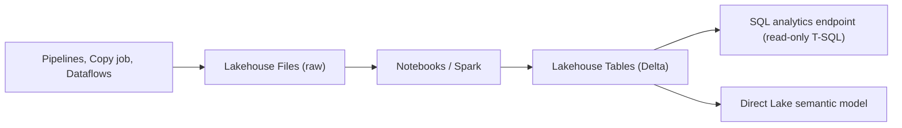
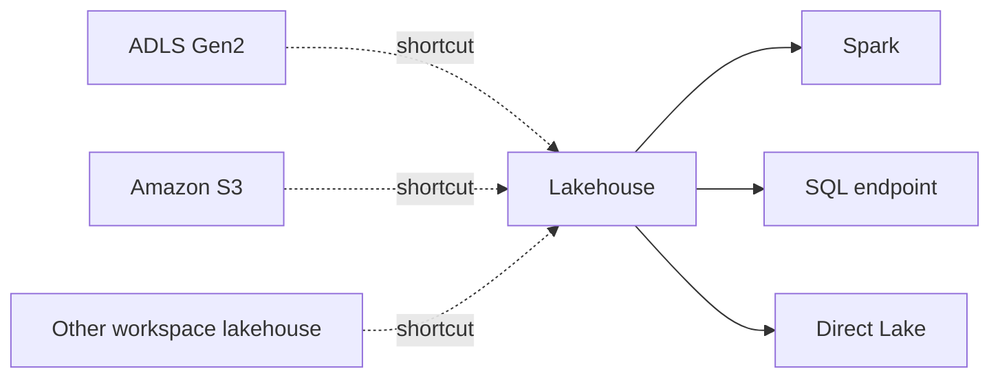

# Lakehouse
id: fabric-m02-lakehouse
track: fabric
verified: 2026-10

## What we're learning
A **Lakehouse** is a Fabric item that stores data in OneLake and is designed to be written mainly by **Spark** (notebooks, Spark job definitions) and by Data Factory. It has two top-level areas:

- **Tables**: managed Delta tables. Fabric discovers and registers them automatically, so they appear in the catalog, the SQL analytics endpoint and Power BI.
- **Files**: any files in any format (CSV, JSON, images, raw extracts). Nothing here is registered as a table.

Every lakehouse automatically gets a read-only **SQL analytics endpoint** for T-SQL queries over its Delta tables. New lakehouses created in the portal support **schemas** (with a fixed `dbo` schema), so Spark can address tables with four-part names: `workspace.lakehouse.schema.table`.

## Benefit
One item holds raw files and curated tables side by side, readable from Spark, SQL and Power BI without copying. It is the natural home for a medallion design and for data scientists working in Python.

## Where it fits

## Limits and misconceptions
- Only Delta tables under Tables show up in the SQL endpoint. Parquet or CSV in Files does not, until you load it into a table or create a shortcut.
- There are no multi-table transactions in a lakehouse. If you need several tables to change atomically, that points to a Warehouse.
- Writes through the SQL endpoint are not possible; it is read-only.
- Older lakehouses without schemas cannot be converted in place yet; you create a new schema-enabled lakehouse.
- Default semantic models are no longer created automatically for lakehouses (since September 2025); you create semantic models explicitly.

## Remember this
A Lakehouse is Spark-first storage with a Files area for anything and a Tables area of Delta tables that every Fabric engine can read.

## Related
fabric-m02-sql-analytics-endpoint, fabric-m10-lakehouse-vs-warehouse, pyspark-m08-medallion, pyspark-m08-delta-lake

# Warehouse
id: fabric-m02-warehouse
track: fabric
verified: 2026-10

## What we're learning
A Fabric **Warehouse** is a relational data warehouse you build and load with **T-SQL**. It supports full DML (`INSERT`, `UPDATE`, `DELETE`, `MERGE`), `CREATE TABLE AS SELECT`, views, functions and stored procedures. Its tables are stored as Delta in OneLake, so Spark and Power BI can read them too, and compute is separate from storage.

Distinctive features:
- **Multi-table ACID transactions** with `BEGIN TRAN ... COMMIT`, including DDL, and even across warehouses in the same workspace.
- **Snapshot isolation** always applies; other isolation levels are ignored.
- Constraints (primary key, unique, foreign key) can be declared but must be `NOT ENFORCED`; they help the optimiser and tools, not data integrity.

## Benefit
Teams with SQL Server or Synapse skills can build star schemas, stored-procedure ELT and transactional loads in familiar T-SQL, without managing distributions, indexes or servers.

## Limits and misconceptions
- The T-SQL surface is not full SQL Server. Not supported as of October 2026 include triggers, materialized views, recursive queries, `FOR XML`, synonyms and `SET TRANSACTION ISOLATION LEVEL`. Check the surface-area page before migrating code.
- Locking is at **table level**: two concurrent updates to the same table can conflict even if they touch different rows, so loads need retry logic or serialisation.
- Some `ALTER TABLE` operations are limited or in preview.
- There are no indexes to tune; performance comes from the engine, statistics and data layout.

## Remember this
The Warehouse is the T-SQL-first, read-write store in Fabric, with multi-table transactions and Delta storage underneath.

## Related
fabric-m10-lakehouse-vs-warehouse, fabric-m08-sql-granular-security, sql-m08-isolation-levels, fabric-m01-fabric-vs-synapse-adf-premium

# SQL analytics endpoint
id: fabric-m02-sql-analytics-endpoint
track: fabric
verified: 2026-10

## What we're learning
The **SQL analytics endpoint** is a read-only T-SQL interface that Fabric creates automatically for each lakehouse, mirrored database and SQL database (exactly one per item). It runs on the same engine as the Warehouse.

You cannot insert or update data through it, but you can create **views, inline functions and stored procedures**, and apply **SQL security**: object grants, row-level security, column-level security and dynamic masking.

A background **metadata sync** reads the Delta logs and keeps the endpoint's table list and schemas in step with what Spark wrote. A newer sync (preview, 2026) aims to make changes visible within seconds; there is also a manual refresh in the portal and a REST API.

## Benefit
SQL analysts and BI tools get a familiar T-SQL connection to lakehouse data without anyone copying it into a warehouse.

## Limits and misconceptions
- **Sync delay**: a table just written by Spark may not be visible, or may show an old schema, for a short time. Pipelines that write with Spark and immediately query with SQL should refresh the metadata first.
- **SQL security applies only to the endpoint.** Someone with Spark or OneLake access (ReadAll) bypasses the RLS and masking you defined in SQL. For consistent protection across engines, use OneLake security.
- External Delta tables created with Spark outside the Tables area are not visible; use shortcuts.
- In **delegated identity mode** the endpoint reads OneLake as the item owner; in **user identity mode** it passes the user's identity, which OneLake security then evaluates.

## Remember this
The SQL analytics endpoint gives read-only T-SQL over lakehouse tables, with a sync delay and with security that protects only the SQL path.

## Related
fabric-m02-lakehouse, fabric-m02-warehouse, fabric-m08-onelake-security, fabric-m08-sql-granular-security

# Shortcuts
id: fabric-m02-shortcuts
track: fabric
verified: 2026-10

## What we're learning
A **shortcut** is a pointer in OneLake to data stored somewhere else. It looks like a folder or table in a lakehouse (or KQL database), but no data is copied.

Targets include other OneLake locations (lakehouses, warehouses, KQL databases, mirrored databases) and external stores: **ADLS Gen2, Azure Blob, Amazon S3, S3-compatible storage, Google Cloud Storage, Dataverse**, Iceberg tables, and OneDrive or SharePoint. On-premises S3-compatible stores can be reached through the on-premises gateway.

In the **Tables** area shortcuts sit at the top level (or as schema shortcuts), and Delta data is recognised as a table. In the **Files** area they can sit anywhere and point at any format. Shortcuts to S3, GCS and gateway targets can be **cached** for 1 to 28 days to cut egress cost.

## Benefit
Shortcuts let you build a lakehouse over data that stays where it is: another team's workspace, an existing ADLS data lake, or another cloud. That avoids copy pipelines, duplicate storage and drift between copies.

## Where it fits

## Limits and misconceptions
- **Security model**: shortcuts to OneLake in the same tenant pass the caller's identity through by default. Shortcuts to external storage always use a **delegated** credential (the connection's key or service principal), so everyone who can read the shortcut reads with that credential. Design access with that in mind.
- Deleting a shortcut does not delete the target, but deleting files *inside* a shortcut deletes them at the target if the credential allows it.
- Performance depends on the target: cross-cloud reads add latency and egress cost.
- Data in a shortcut is not backed up or governed by OneLake soft delete.

## Remember this
A shortcut is a zero-copy pointer to data elsewhere; external shortcuts read with a shared delegated credential.

## Related
fabric-m01-onelake, fabric-m02-mirroring, fabric-m08-onelake-security, tools-m03-object-storage

# Mirroring
id: fabric-m02-mirroring
track: fabric
verified: 2026-10

## What we're learning
**Mirroring** continuously replicates data from an operational or analytical source into OneLake as Delta tables, without you building pipelines. It reads the source's change stream and applies changes in near real time (changes can publish as often as every 15 seconds). Each mirrored database gets a SQL analytics endpoint and can feed Direct Lake.

Three kinds:
- **Database mirroring**: copies data. Sources listed in October 2026 include Azure SQL Database, Azure SQL Managed Instance, SQL Server, Azure Cosmos DB, Azure Database for PostgreSQL, Snowflake, Google BigQuery, Oracle and SAP Datasphere, with others in preview.
- **Metadata mirroring**: syncs catalog metadata and uses shortcuts instead of copying, for example for Azure Databricks Unity Catalog.
- **Open mirroring**: a public API and landing zone so partners or your own code can push change data in a documented format.

## Benefit
It replaces a whole class of CDC pipelines for common sources, and the replication itself is cheap: compute for replication does not consume capacity units, and storage up to 1 TB per CU of capacity is free (for example 64 TB on an F64). Querying the mirrored data is billed normally.

## Limits and misconceptions
- Mirrored tables are **read-only replicas**. Transformations happen downstream in Spark, SQL or dataflows.
- It is near real time, not transactional consistency across tables at every instant.
- Each source has its own prerequisites and limits (supported data types, table counts, network access). Check the source's page.
- If the capacity is paused, replication stops.
- Microsoft's guidance: mirroring suits data that is already clean (often the gold layer of another system); Copy job suits raw ingestion you will transform.

## Remember this
Mirroring is managed, near real-time replication of a source into read-only Delta tables in OneLake, with free replication compute.

## Related
tools-m01-ingestion-styles, tools-m01-debezium, fabric-m03-copy-job, fabric-m02-shortcuts

# Delta format in Fabric
id: fabric-m02-delta-in-fabric
track: fabric
verified: 2026-10

## What we're learning
Delta Lake is Fabric's common table format. Lakehouse tables, Warehouse tables, mirrored databases and Eventhouse's OneLake copies are all Delta in OneLake, which is why every engine can read every table. (The concepts of Delta, such as the transaction log, time travel and compaction, are explained in the PySpark track.)

Fabric-specific points:
- **V-Order** is a write-time optimisation of Parquet layout that speeds up reads in the SQL engine and Direct Lake at the cost of slower writes (Microsoft cites about 15 percent). Files stay standard Parquet. For new workspaces V-Order is **off by default** for Spark writes, and turned on by read-heavy resource profiles or table properties.
- **Table maintenance** (OPTIMIZE to compact files, VACUUM to remove old files, default retention 7 days) can be run from the lakehouse UI, notebooks, the REST API or a pipeline activity.
- **Iceberg interoperability**: OneLake generates Iceberg metadata for Delta tables and Delta metadata for Iceberg tables, so Iceberg engines (for example Snowflake) can read Fabric tables and Fabric can read Iceberg data through shortcuts. There are limits on features and table history.

## Benefit
One open format means no proprietary lock-in for the storage layer and no copies between engines. Understanding V-Order and maintenance is the difference between a fast and a slow Direct Lake report.

## Limits and misconceptions
- Small files from frequent appends or streaming hurt every engine. Schedule compaction.
- Direct Lake guardrails count Parquet files and row groups per table, so unmaintained tables can exceed them.
- Delta features written by newer writers (deletion vectors, column mapping) may not be readable by every engine or older runtime. Check compatibility before enabling them.

## Remember this
Everything in Fabric is Delta in OneLake; V-Order and regular compaction decide how fast it reads.

## Related
pyspark-m08-delta-lake, pyspark-m08-delta-optimize-clustering, tools-m03-format-interoperability, fabric-m07-direct-lake
