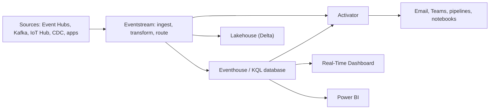

# Real-Time Intelligence overview
id: fabric-m05-rti-overview
track: fabric
verified: 2026-10

## What we're learning
**Real-Time Intelligence** is Fabric's workload for data in motion: telemetry, logs, clickstreams, IoT readings, change events. It brings together:

- **Real-Time hub**: a tenant-wide catalog of streams, KQL tables and system events (Fabric workspace and OneLake events, Azure Blob events), with connectors to external sources.
- **Eventstream**: ingests, transforms and routes events without code.
- **Eventhouse** with **KQL databases**: stores and queries large volumes of time-stamped data with Kusto Query Language.
- **Real-Time Dashboard**: KQL-backed tiles that refresh in seconds.
- **Activator**: watches data and triggers alerts or actions when conditions are met.

## Benefit
One integrated path from event to insight to action, without assembling Event Hubs, Stream Analytics, Data Explorer and Logic Apps yourself.

## Where it fits

## Use case
A manufacturer streams machine telemetry: Eventstream filters and routes it, Eventhouse stores months of readings for KQL analysis, a Real-Time Dashboard shows the live line, and Activator emails maintenance when a temperature rises for five minutes.

## Limits and misconceptions
- Choose by job: Eventstream to **move and shape** events, Eventhouse to **store and query** them, dashboards to **see** them, Activator to **act** on them. Microsoft describes this flow but does not publish a strict decision table.
- Spark Structured Streaming in notebooks is still an option, especially for complex stateful logic or writing to Delta, and Eventstream can hand data to it.
- Streaming costs capacity continuously, not just when someone looks.

## Remember this
Real-Time Intelligence chains Eventstream to move, Eventhouse to store and query, dashboards to watch and Activator to act.

## Related
fabric-m05-eventstreams, fabric-m05-eventhouse-kql, tools-m01-ingestion-styles, pyspark-m09-streaming-model

# Eventstreams
id: fabric-m05-eventstreams
track: fabric
verified: 2026-10

## What we're learning
An **Eventstream** is a no-code pipeline for events. You add **sources** (Azure Event Hubs, IoT Hub, Event Grid, Service Bus, Kafka and Confluent, Amazon Kinesis and MSK, Google Pub/Sub, database CDC from SQL Server, Azure SQL, PostgreSQL, MySQL, Cosmos DB and others, plus a custom endpoint for your own apps), optional **transformations** (filter, manage fields, aggregate, group by time windows, union, expand, join, and a SQL operator in preview), and **destinations** (Eventhouse, Lakehouse, Activator, a custom endpoint, or a **derived stream** that others can subscribe to in the Real-Time hub).

Each eventstream also exposes a **Kafka-compatible endpoint**, so existing Kafka producers can send to it with a connection-string change.

## Benefit
Routing and light shaping of streams takes minutes in a designer instead of writing and operating streaming code.

## Limits and misconceptions
- Delivery is **at-least-once**: downstream stores should tolerate duplicates.
- Messages are limited to 1 MB and retained up to 90 days.
- Transformations are deliberately simple. Complex stateful logic, joins with large reference data or custom code belong in Spark or KQL update policies.
- Microsoft recommends at least an F4 capacity for eventstreams.

## Remember this
Eventstream connects, shapes and routes events without code, with at-least-once delivery.

## Related
tools-m02-event-hubs, tools-m02-kafka, fabric-m05-eventhouse-kql, pyspark-m09-exactly-once

# Eventhouse and KQL databases
id: fabric-m05-eventhouse-kql
track: fabric
verified: 2026-10

## What we're learning
An **Eventhouse** is a container for one or more **KQL databases**, the same engine as Azure Data Explorer. It is optimised for append-heavy, time-stamped data: logs, telemetry, events. Data is indexed and compressed on ingestion, and queried with **Kusto Query Language (KQL)**, a pipe-based language (`Table | where ... | summarize ... by bin(Timestamp, 5m)`). T-SQL is also partly supported.

**OneLake availability** can be switched on per database or table: the data is then also written as Delta tables in OneLake (at no extra storage cost), readable by Spark, the SQL endpoint and Direct Lake. Latency of that copy is minutes to hours, configurable.

Eventhouse replaces Azure Synapse Data Explorer, which was retired in October 2025.

## Benefit
Interactive queries over billions of recent events in seconds, with time-series functions (binning, anomaly detection, forecasting) built into the language.

## Limits and misconceptions
- It is not a general warehouse: updates and deletes are expensive and limited, and joins of large tables are not its strength.
- While OneLake availability is on, some operations (renaming tables, changing column types, purging data) are restricted.
- KQL is another language for the team to learn, although Copilot can generate KQL from questions.

## Remember this
Eventhouse is Fabric's engine for fast queries over append-only event data, with an optional Delta copy in OneLake.

## Related
fabric-m05-real-time-dashboards, fabric-m10-lakehouse-vs-warehouse, tools-m08-clickhouse, fabric-m05-rti-overview

# Activator
id: fabric-m05-activator
track: fabric
verified: 2026-10

## What we're learning
**Activator** (formerly Data Activator; items still appear with the type name Reflex) watches data and acts when a condition is met. You define **objects** (things identified by a key, such as a machine or a store), their **properties** (temperature, sales today), and **rules** such as "becomes greater than", "increases by", "no data for 10 minutes". When a rule fires, Activator runs an **action**: email, Teams message, Power Automate flow, or starting a Fabric pipeline, notebook, Spark job, dataflow or function.

Sources include eventstreams, Fabric and Azure events, Power BI visuals and Real-Time Dashboards.

## Benefit
It closes the loop from data to action without writing a monitoring service. It is also how Fabric's own event-driven pipeline triggers work.

## Limits and misconceptions
- Rules are evaluated per object; design object keys carefully or you get one alert per row.
- It is not a workflow engine: complex multi-step remediation belongs in pipelines or Power Automate, which Activator can start.
- Alert fatigue is a design problem; use stateful conditions (for example "for 5 minutes") rather than single readings.

## Remember this
Activator turns conditions in data into alerts and actions, per tracked object.

## Related
fabric-m05-eventstreams, fabric-m03-pipelines, fabric-m05-rti-overview

# Real-time dashboards
id: fabric-m05-real-time-dashboards
track: fabric
verified: 2026-10

## What we're learning
A **Real-Time Dashboard** is a Fabric item whose tiles each run a **KQL query** against an Eventhouse, Azure Data Explorer or Azure Monitor. Tiles refresh automatically (down to seconds), support parameters and pages, and can be exported as JSON.

A **Power BI report** is built on a semantic model, with rich visuals and modelling (DAX measures, relationships), and refreshes on a schedule or through Direct Lake or DirectQuery.

## Benefit
Operations teams get live monitoring screens straight from event data, without building a semantic model.

## Compared with
| | Real-Time Dashboard | Power BI report |
|---|---|---|
| Query language | KQL per tile | DAX over a semantic model |
| Freshness | Seconds | Minutes or on refresh (DirectQuery for live) |
| Modelling | None | Relationships, measures, RLS |
| Audience | Operations, engineers | Business users, management |

## Limits and misconceptions
- Each tile is its own query; dozens of tiles refreshing every few seconds put load on the Eventhouse and capacity.
- No shared business logic layer: a metric defined in one tile's KQL is not reused elsewhere.
- For a reliable KPI that many people consume, a semantic model is still the better home.

## Remember this
Real-time dashboards are KQL tiles for live operational monitoring; Power BI reports are for modelled business reporting.

## Related
fabric-m07-reports, fabric-m05-eventhouse-kql, fabric-m07-semantic-models
