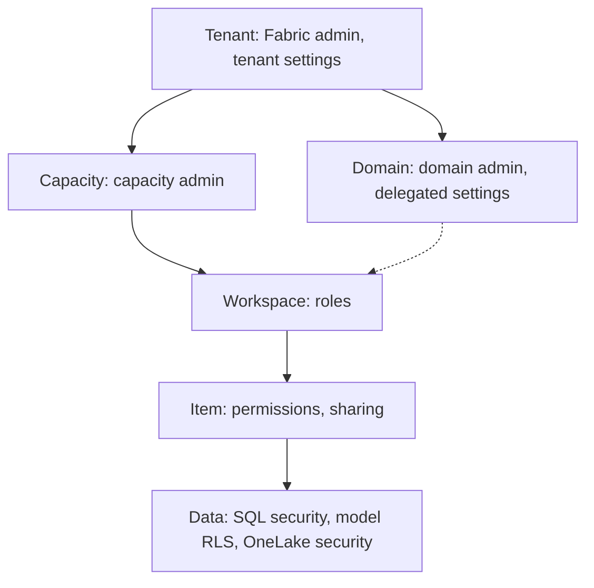

# Governance model in Fabric
id: fabric-m08-governance-overview
track: fabric
verified: 2026-10

## What we're learning
Fabric governance is a **delegated model**: a small central team sets guardrails, and control is pushed down to the people closest to the data. The layers, from widest to narrowest:

1. **Tenant**: Fabric administrators (formerly Power BI administrators) manage tenant settings, capacities overview, auditing and domains. Microsoft 365 roles (Global, Billing, License admins) handle licences.
2. **Capacity**: capacity admins decide which workspaces run on a capacity and who can assign to it.
3. **Domain**: domain admins manage their business area's domains, contributors and delegated settings.
4. **Workspace**: workspace admins manage members, roles and Git connections.
5. **Item**: owners share items and grant item permissions.
6. **Data**: engine-level security (SQL grants, RLS, CLS, masking), semantic model RLS, and **OneLake security** roles.

Access is evaluated in order: Entra ID authentication, then Fabric access (workspace role or item permission), then data security inside the item.

Day-to-day administration is moving into the **OneLake catalog's Govern tab**, with the classic admin portal as fallback.

## Benefit
A clear model of who controls what stops two common failures: central admins drowning in requests, and business teams creating ungoverned sprawl.

## Where it fits

## Limits and misconceptions
- Tenant settings are feature switches, **not data security**. Disabling export does not remove a user's read access.
- Workspace roles are broad. Anyone with Contributor or above can read all data in the workspace through Spark.
- Governance also needs process: naming, ownership, endorsement and review. Tools cannot replace an operating model.

## Remember this
Fabric governance flows from tenant to capacity and domain, to workspace, item and finally data-level security, and each layer has its own admin.

## Related
fabric-m08-tenant-settings, fabric-m08-domains, fabric-m08-workspace-roles, fabric-m08-onelake-security

# Tenant settings and admin portal
id: fabric-m08-tenant-settings
track: fabric
verified: 2026-10

## What we're learning
**Tenant settings** switch Fabric features on or off for the organisation. Each setting can be disabled, enabled for everyone, enabled for specific security groups, or enabled for everyone except listed groups. Changes can take up to 15 minutes.

Many settings can be **delegated**: from the tenant to a capacity **or** a domain (not both), and further to workspaces. That lets, for example, the finance domain allow certification with its own certifiers.

Settings that matter most for governance (names as of October 2026):
- Who may create Fabric items and workspaces.
- **Service principals**: "can create workspaces, connections, and deployment pipelines" and "can call Fabric public APIs" (these replaced a single older setting), plus read-only admin API access for catalog scanners.
- Export and sharing: export to Excel or CSV, publish to web, external sharing, guest access.
- "Users can access data stored in OneLake with apps external to Fabric".
- Sensitivity labels, Copilot and cross-geo AI processing.
- Private links and blocking public internet access.

Settings are found under **OneLake catalog > Govern > Configurations**, or the classic **Admin portal**.

## Benefit
Tenant settings are the first and cheapest control: they stop risky features (public web publishing, uncontrolled service principals) before anyone uses them.

## Limits and misconceptions
- In Microsoft's words, tenant settings are not a security measure; they control features, not data access.
- Group-based settings are only as good as your Entra group hygiene.
- Defaults change as Microsoft adds features. Review new settings in each monthly release, and audit changes (`UpdatedAdminFeatureSwitch` events).

## Remember this
Tenant settings switch features on or off for chosen groups and can be delegated to domains or capacities, but they do not secure data.

## Related
fabric-m08-governance-overview, fabric-m08-auditing-monitoring, fabric-m09-apis-automation

# Domains
id: fabric-m08-domains
track: fabric
verified: 2026-10

## What we're learning
A **domain** groups workspaces by business area: Finance, Sales, Manufacturing. **Subdomains** add one more level. Every item in an associated workspace inherits the domain, which shows up as a filter and visual theme in the OneLake catalog.

Roles:
- **Fabric admins** create domains and assign domain admins.
- **Domain admins** manage their domains: description, image, contributors, workspace assignment and **delegated settings** (for example a default sensitivity label for the domain, or who can certify items).
- **Domain contributors** (who must be workspace admins) can assign their own workspaces to the domain.

Workspaces can be assigned by name, by workspace admin, or in bulk by capacity. A **default domain** can automatically capture new workspaces created by specified users.

## Benefit
Domains are Fabric's building block for **data mesh** and federated governance: each business area owns and curates its data, discovery is organised by business language, and some governance decisions move to the domain.

## Limits and misconceptions
- **Domains do not control access.** Assigning a workspace to a domain changes nothing about who can see or read its items; every user can see every domain.
- Subdomains have no admins of their own; they inherit the parent's.
- Domain design is an organisational decision. Mirror stable business ownership, not the current org chart or project names.

## Remember this
Domains group workspaces by business area for discovery and delegated settings, but they are not a security boundary.

## Related
fabric-m08-governance-overview, tools-m06-catalogs-explained, databricks-m08-governance-patterns, fabric-m08-endorsement

# Workspace roles
id: fabric-m08-workspace-roles
track: fabric
verified: 2026-10

## What we're learning
Every workspace has four roles, assigned to users, security groups, Microsoft 365 groups or service principals:

| Capability | Admin | Member | Contributor | Viewer |
|---|---|---|---|---|
| Manage workspace, delete it, connect to Git | Yes | | | |
| Add members and lower roles | Yes | Yes | | |
| Share items, allow resharing | Yes | Yes | With reshare | With reshare |
| Create, edit and delete items; write data; run notebooks and pipelines | Yes | Yes | Yes | |
| Read all data through Spark and OneLake (ReadAll) | Yes | Yes | Yes | |
| Read data through the SQL endpoint (ReadData) | Yes | Yes | Yes | Yes |

Group assignments are cumulative; a user gets the highest role from any group.

## Benefit
Roles give a simple, auditable default: builders get Contributor, consumers get Viewer, and only a few people get Admin.

## Limits and misconceptions
- Contributor and above can read **every table in every lakehouse** of the workspace through Spark, and they hold CONTROL on warehouses, so they see **unmasked** data. Dynamic data masking does not protect against them.
- Viewers can query lakehouse data through the SQL endpoint unless SQL security restricts it, but they have no Spark or file access.
- Because roles are workspace-wide, separate workspaces (for example raw, curated and consumption) are often needed to separate who can see what.
- Prefer security groups over individuals, so access follows joiners and leavers.

## Remember this
Workspace roles are coarse: Contributor and above can read and change all data in the workspace, so design workspaces around who should see what.

## Related
fabric-m08-item-permissions, fabric-m08-onelake-security, snowflake-m06-rbac, databricks-m02-privileges

# Item permissions and sharing
id: fabric-m08-item-permissions
track: fabric
verified: 2026-10

## What we're learning
To give someone access to one item without a workspace role, you **share** it. Sharing grants **Read** by default, which means "see and open the item", not "read its data". Extra permissions widen access:

- **ReadData**: read all tables through the SQL analytics endpoint or warehouse (like `db_datareader`).
- **ReadAll**: read the underlying files through Spark and OneLake APIs.
- **Build**: create new content (reports) on a semantic model.
- **Reshare**: share the item onward.
- **Execute** (lakehouse): run Spark through the API.
- **Write** is never granted by sharing; it comes only from a workspace role.

For a warehouse, plain Read gives only a connection; you then grant SQL permissions on specific tables or views.

## Benefit
Item permissions are how you serve data to consumers in other teams without making them members of your workspace, which keeps the producing workspace's role list small.

## Limits and misconceptions
- ReadData and ReadAll are separate paths: granting one does not grant the other, and SQL-level security does not restrict ReadAll.
- Removing an item permission does not remove access that comes from a workspace role.
- Changes can take time to propagate (up to two hours in some cases, per the docs).
- Reports in Direct Lake or DirectQuery mode need the viewer to have data access on the source; import-mode reports do not.

## Remember this
Sharing grants Read only; ReadData opens the SQL path, ReadAll opens the Spark and file path, and write access needs a workspace role.

## Related
fabric-m08-workspace-roles, fabric-m08-onelake-security, fabric-m08-sql-granular-security

# OneLake security
id: fabric-m08-onelake-security
track: fabric
verified: 2026-10

## What we're learning
**OneLake security** (which grew out of "OneLake data access roles") defines **roles inside an item** that grant access to specific tables, folders or schemas, optionally with **row-level** and **column-level** filters. Because the rules are stored with the data in OneLake, they are enforced across engines: Spark notebooks, the lakehouse explorer, the SQL analytics endpoint in user-identity mode, and Direct Lake on OneLake semantic models. Microsoft's documentation listed these engines as GA in 2026, with Eventhouse (row-level only) and third-party engines in preview.

Key rules:
- Roles only **grant**; there is no deny. Access is denied by default unless a role grants it.
- Permissions are **Read** or **ReadWrite**.
- Each item starts with a **DefaultReader** role containing everyone who has ReadAll; edit or remove it to restrict access.
- Within a role, table, row and column rules intersect. Across roles, access is the union.
- Through a shortcut, a user needs access at both the shortcut and the target.

## Benefit
One definition of "who can see which rows and columns" that holds whether someone uses SQL, Spark or Power BI. That closes the classic gap where SQL security was bypassed by reading files with Spark.

## Limits and misconceptions
- Workspace Admins, Members and Contributors are not restricted by these roles; they apply to Viewers and people with item permissions.
- Engines that cannot enforce row or column filters are **blocked** from the secured table rather than given unfiltered data.
- Limits apply: roles per item, members per role, and propagation delays (minutes for role changes, longer for group membership).
- Some docs still called the feature preview in 2026. Check the current status for each engine before relying on it.

## Remember this
OneLake security puts table, row and column permissions on the data itself, so SQL, Spark and Direct Lake all enforce the same rules.

## Related
fabric-m08-sql-granular-security, fabric-m02-shortcuts, fabric-m07-direct-lake, databricks-m02-privileges

# Row, column and object level security
id: fabric-m08-sql-granular-security
track: fabric
verified: 2026-10

## What we're learning
Inside the **Warehouse and SQL analytics endpoint**, standard T-SQL security applies:

- **Object-level security**: `GRANT`, `DENY`, `REVOKE` on tables, views, functions and procedures.
- **Column-level security**: grant `SELECT` on specific columns only.
- **Row-level security (RLS)**: a security policy plus an inline table-valued function decides which rows each user sees. It applies to everyone, including admins, unless the predicate exempts them.
- **Dynamic data masking (DDM)**: show masked values (`XXXX`, partial email) to users without the `UNMASK` permission.

In **semantic models**, RLS and object-level security are defined with DAX roles and apply to anyone querying through the model or its reports.

## Benefit
These are the familiar SQL Server tools, so existing security designs from on-premises warehouses can often be carried over.

## Limits and misconceptions
- SQL security protects **only the SQL path**. Users with ReadAll or a Contributor role can read the files with Spark. Use OneLake security for cross-engine rules.
- Contributors and above have CONTROL and therefore see unmasked data. Masking is a convenience, not a strong control; Microsoft warns it can be bypassed by inference.
- Direct Lake on SQL endpoints falls back to slower DirectQuery when SQL RLS or object security exists.
- Two security layers (SQL and model) can disagree. Decide where each rule lives and document it.

## Remember this
T-SQL grants, RLS and masking protect the SQL path and model RLS protects the model; neither stops Spark reads on its own.

## Related
fabric-m08-onelake-security, snowflake-m06-row-access-policies, snowflake-m06-masking-policies, sql-m10-functions

# Sensitivity labels and DLP
id: fabric-m08-sensitivity-labels
track: fabric
verified: 2026-10

## What we're learning
**Sensitivity labels** from Microsoft Purview Information Protection (for example Public, General, Confidential, Highly Confidential) can be applied to Fabric items. They classify data and, for some export paths, protect it: a report exported to Excel, PowerPoint or PDF carries the label and its encryption.

Labels move with the data:
- **Downstream inheritance**: a label on a lakehouse flows to items built from it, and a semantic model's label flows to its reports.
- **Inheritance from data sources**: semantic models can pick up labels from sources such as Azure SQL.
- **Default** and **mandatory** labelling can be required; mandatory labelling is fully enforced for Power BI items.

**Data loss prevention (DLP) policies** from Purview scan semantic models, lakehouses, warehouses, KQL and mirrored databases for sensitive information (credit card numbers, IDs) or labels, then show policy tips, send alerts, or restrict access (preview). **Protection policies** go further: for items with a chosen label, only listed users and groups keep access.

## Benefit
Classification that travels from source to report, plus automated detection, is what lets a regulated organisation prove where sensitive data is and who touched it.

## Limits and misconceptions
- Labels are metadata plus some export protection; they do not by themselves restrict who can query data inside Fabric. Protection policies and permissions do that.
- Inheritance does not go from Power BI items back to Fabric items.
- CSV exports and some other paths are not protected by labels.
- DLP evaluation uses capacity and supports a subset of sensitive information types.
- A Purview licence and published labels are prerequisites.

## Remember this
Sensitivity labels classify and travel downstream, DLP detects sensitive data, and protection policies restrict access by label.

## Related
fabric-m08-purview-integration, fabric-m08-domains, snowflake-m06-tags-classification, ai-m08-privacy

# Microsoft Purview and the OneLake catalog
id: fabric-m08-purview-integration
track: fabric
verified: 2026-10

## What we're learning
Two catalogs meet here:

- The **OneLake catalog** is Fabric's built-in catalog, with three tabs. **Explore** helps users find items by domain, type, owner and endorsement. **Govern** shows owners and admins insights (label coverage, unendorsed items, sensitive data) and recommended actions, and now also hosts most admin settings. **Secure** gives one view of workspace roles and OneLake security roles.
- **Microsoft Purview** is the enterprise governance suite across Azure, on-premises, multicloud and Microsoft 365. Its **Data Map** can scan a Fabric tenant (full, incremental or scoped scans) to pull Fabric metadata and lineage into the **Unified Catalog**, alongside other sources. Purview also provides the labels, DLP and audit used by Fabric.

## Benefit
Fabric-only organisations can start with the OneLake catalog at no extra effort. Organisations with data outside Fabric (SAP, Snowflake, on-premises SQL) use Purview to see everything in one catalog with one glossary.

## Limits and misconceptions
- Purview scanning of non-Power BI Fabric items is at **item level**: lakehouse tables get metadata but not table-level lineage inside the item.
- Once metadata is in Purview, Purview permissions decide who can see it, not Fabric permissions.
- Tenant-level private links block Purview scanning and the Govern tab.
- The older Purview hub in Fabric has been replaced by the Govern experience.

## Remember this
The OneLake catalog governs what is in Fabric; Purview governs the whole estate and scans Fabric into it.

## Related
tools-m06-purview, fabric-m08-lineage-impact, fabric-m08-sensitivity-labels, tools-m06-catalogs-explained

# Lineage and impact analysis
id: fabric-m08-lineage-impact
track: fabric
verified: 2026-10

## What we're learning
Fabric captures **item-level lineage** automatically: which source feeds which pipeline or dataflow, which lakehouse feeds which semantic model, which model feeds which report.

- The **lineage view** of a workspace shows all its items and their connections, plus upstream sources one level outside the workspace.
- **Impact analysis** on an item shows everything downstream of it, **across workspaces**, and lets you email the contacts of affected workspaces before a breaking change.

## Benefit
Before you drop a column or rename a table, impact analysis shows which reports and models will break and who owns them. That is the everyday value of lineage for a migration or governance team.

## Limits and misconceptions
- The lineage view does not show downstream items in **other** workspaces; use impact analysis for that.
- Lineage is item-level. Column-level lineage is not documented for Fabric's built-in view (October 2026), and code inside notebooks is not parsed into table-to-table lineage the way Unity Catalog does.
- Impact analysis needs write permission on the item; items you cannot access appear as "limited access".
- For estate-wide lineage across Fabric and other platforms, use Purview or an OpenLineage-based tool.

## Remember this
Fabric lineage is item-level: the lineage view shows a workspace, impact analysis shows everything downstream across workspaces.

## Related
tools-m06-lineage, pyspark-m11-data-lineage, databricks-m02-lineage, fabric-m08-purview-integration

# Endorsement
id: fabric-m08-endorsement
track: fabric
verified: 2026-10

## What we're learning
**Endorsement** marks items that people can trust. There are three badges:

- **Promoted**: the owner (anyone with write permission) says "this is ready to share". No approval needed.
- **Certified**: an authorised reviewer says "this meets the organisation's quality standard". Only users the Fabric admin names can certify, and certification can be **delegated to domains** with their own certifiers.
- **Master data**: an authorised person marks the item as the authoritative source for core data such as customers or products. Applies to data items such as lakehouses and semantic models.

Endorsed items rank higher in search and are highlighted in the OneLake catalog.

## Benefit
In a self-service platform there are always five versions of "sales". Endorsement tells consumers which one to use, which is cheaper than preventing the other four from existing.

## Limits and misconceptions
- A badge is only as good as the process behind it. Define what certification requires (documentation, tests, owner, refresh SLA) and review regularly.
- Endorsement is not copied by deployment pipelines; certify the production item.
- Certification must be enabled by an admin; promotion is available to item writers.

## Remember this
Promoted is the owner's claim, certified is a reviewer's approval, and master data marks the authoritative source.

## Related
fabric-m08-domains, fabric-m08-purview-integration, tools-m07-data-contracts

# Auditing and monitoring
id: fabric-m08-auditing-monitoring
track: fabric
verified: 2026-10

## What we're learning
Fabric has several monitoring tools, each answering a different question:

- **Audit log** (in Microsoft Purview Audit): *who did what?* Every view, share, export, permission change and setting change is recorded. Searched in the Purview portal with the Audit Logs role, or exported for long-term retention.
- **Admin monitoring workspace**: *how is the tenant used?* A read-only workspace with daily-refreshed reports on activity, content and feature usage. Its governance reports now sit in the Govern report.
- **Fabric Capacity Metrics app**: *how hard is my capacity working?* CU consumption by item and operation, throttling and overload, over the last 14 days.
- **Chargeback app**: *who should pay?* Usage by workspace, domain, item and user.
- **Monitoring hub**: *did my jobs run?* Status of pipeline, notebook, dataflow and other runs.
- **Workspace monitoring**: *what is happening inside my workspace?* Detailed logs and metrics written to an Eventhouse you can query with KQL.

## Benefit
Together they answer the governance team's standing questions: compliance (audit), adoption (admin monitoring), cost (metrics and chargeback) and reliability (monitoring hub and workspace monitoring).

## Limits and misconceptions
- Audit search covers a limited default window and retention depends on your Purview audit policy; export logs if you need years of history.
- The Capacity Metrics app and admin monitoring workspace do not work with tenant-level Private Link.
- Workspace monitoring collection is off by default and consumes capacity.
- Some of these tools were preview or changing in 2026; check current status.

## Remember this
Audit logs say who did what, the metrics app says how busy the capacity is, and the monitoring hub says whether jobs ran.

## Related
fabric-m01-licensing-capacity, fabric-m10-capacity-sizing-cost, databricks-m02-system-tables, fabric-m08-tenant-settings
