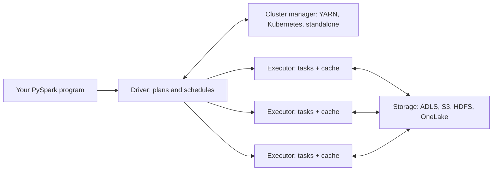
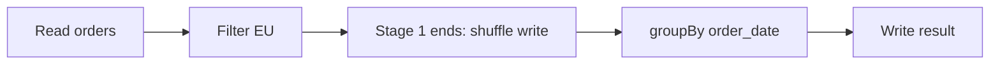

# Spark architecture: driver, executors, cluster manager
id: pyspark-m01-spark-architecture
track: pyspark

## What we're learning
A Spark application is one **driver** process plus many **executor** processes. The driver runs your program, builds the plan and hands out work. Executors run that work on slices of the data and keep cached data in memory. A **cluster manager** (YARN, Kubernetes, Spark's own standalone manager, or a managed platform's equivalent) decides which machines the executors start on and how much CPU and memory they get.

Work is cut into **tasks**. One task handles one partition of data on one executor core. A cluster with 10 executors of 4 cores each can run 40 tasks at the same time.

## Benefit
Knowing who does what explains most Spark behaviour: why `collect()` on a large DataFrame crashes the driver, why a job with 8 partitions cannot use 200 cores, and why a lost executor slows a job down but does not fail it.

## Where it fits


In PySpark the driver also hosts a Python process that talks to the JVM driver through Py4J. Python code you write as DataFrame operations is translated into JVM plans, so most work never runs in Python at all. Python UDFs are the exception.

## Limits and misconceptions
- The driver is a single point of failure. If it dies, the application dies.
- Data does not flow through the driver unless you ask for it (`collect()`, `toPandas()`, large broadcast variables).
- More executors only help if there are enough partitions to keep them busy.
- On managed platforms (Databricks, Fabric) you rarely see the cluster manager directly, but the driver and executor model is the same.

## Remember this
The driver plans, the executors do the work one partition per task, and the cluster manager supplies the machines.

## Related
pyspark-m10-cluster-managers, pyspark-m07-stages-tasks-scheduler, pyspark-m07-partitions, pyspark-m04-udfs


# SparkSession, SparkContext and running locally
id: pyspark-m01-sparksession
track: pyspark

## What we're learning
`SparkSession` is the single entry point to Spark in modern code. You use it to read data, run SQL, create DataFrames and set configuration. It wraps the older `SparkContext`, which is the low-level connection to the cluster and the entry point for RDDs. Since Spark 2.0 you rarely touch `SparkContext` directly; it is still there as `spark.sparkContext`.

On Databricks, Fabric and most notebooks a session called `spark` already exists. In your own scripts you create one with the builder, which returns the existing session if there is one.

## Benefit
One object gives you every API, and the builder pattern makes the same script run locally, on a cluster, or in a notebook with no change apart from configuration.

## Code snippet
```python
from pyspark.sql import SparkSession

spark = (SparkSession.builder
         .appName("orders-report")
         .master("local[*]")                          # local mode: all cores of this machine
         .config("spark.sql.shuffle.partitions", "8")  # small data, few partitions
         .getOrCreate())

df = spark.read.parquet("data/orders")
spark.sparkContext.setLogLevel("WARN")               # SparkContext is still reachable
```

## Use case
Local mode (`local[*]`) runs the driver and executors as threads in one process. It is how you learn Spark, run unit tests and debug logic on a sample. Installing is `pip install pyspark` plus a Java runtime.

## Limits and misconceptions
- Local mode hides problems that only appear on a cluster: shuffles across the network, executor memory limits, skew.
- `getOrCreate()` reuses an existing session, so configuration passed later may be ignored for settings that only apply at start-up.
- With Spark Connect the session is a thin client and `sparkContext` is not available.

## Remember this
SparkSession is the one door into Spark; SparkContext is the older, lower-level door it wraps.

## Related
pyspark-m14-spark-connect, pyspark-m12-testing-pytest, pyspark-m01-spark-architecture


# RDD vs DataFrame (and a note on Dataset)
id: pyspark-m01-rdd-vs-dataframe
track: pyspark

## What we're learning
Spark has three data abstractions:

- **RDD** (Resilient Distributed Dataset): a distributed collection of arbitrary objects. You transform it with functions such as `map` and `filter`. Spark cannot see inside your functions, so it cannot optimise them.
- **DataFrame**: a distributed table with named, typed columns. You describe *what* you want with column expressions or SQL, and the Catalyst optimiser decides *how*.
- **Dataset**: a typed version of the DataFrame that exists only in Scala and Java. In Python there is no Dataset API; a DataFrame is the equivalent, and in Scala a DataFrame is simply `Dataset[Row]`.

## Benefit
Choosing DataFrames gets you query optimisation, compact columnar memory (Tungsten), and code that runs mostly in the JVM rather than in slow Python workers. For PySpark users the difference is often 10 times or more on the same job.

## Code snippet
```python
# RDD: Spark sees opaque Python lambdas, every row goes through Python
rdd = spark.sparkContext.textFile("sales.csv")
total = rdd.map(lambda l: l.split(",")).filter(lambda r: r[2] == "EU") \
           .map(lambda r: float(r[3])).sum()

# DataFrame: Spark sees column expressions, plans and optimises them
from pyspark.sql import functions as F
total = (spark.read.option("header", True).csv("sales.csv")
         .filter(F.col("region") == "EU")
         .agg(F.sum(F.col("amount").cast("double"))))
```

## Limits and misconceptions
- RDDs are not deprecated, but new libraries and features (Structured Streaming, Delta, Spark Connect) are built on DataFrames.
- Use an RDD only for genuinely unstructured processing or legacy code. Even then, convert to a DataFrame as early as you can.
- A DataFrame is not a pandas DataFrame: it is distributed, immutable and lazily evaluated.

## Compared with
| | RDD | DataFrame |
|---|---|---|
| Structure | Any objects | Named, typed columns |
| Optimiser | None | Catalyst + Tungsten |
| Python cost | Every row serialised to Python | Mostly JVM-only |
| Typical use | Legacy, low-level control | Almost everything |

## Remember this
In PySpark, use DataFrames; RDDs are a low-level escape hatch and Dataset is a Scala and Java idea.

## Related
pyspark-m07-catalyst-and-tungsten, pyspark-m01-lazy-evaluation, pyspark-m14-pandas-api-on-spark


# Lazy evaluation: transformations and actions
id: pyspark-m01-lazy-evaluation
track: pyspark

## What we're learning
Spark operations come in two kinds:

- **Transformations** (`select`, `filter`, `join`, `groupBy`, `withColumn`) return a new DataFrame and only add a step to a plan. Nothing is read or computed.
- **Actions** (`count`, `collect`, `show`, `write`, `toPandas`) need a result, so they make Spark optimise the whole plan and run it.

Transformations are also either **narrow** (each output partition depends on one input partition, such as `filter`) or **wide** (output needs data from many partitions, such as `groupBy` or `join`). Wide transformations cause a shuffle.

## Benefit
Because Spark sees the full plan before running anything, it can push filters down to the source, read only needed columns, reorder joins and merge steps. It also means a long chain of transformations costs nothing until you need the answer.

## Code snippet
```python
df = spark.read.parquet("/data/orders")            # transformation: nothing read yet
eu = df.filter(df.region == "EU")                   # transformation
by_day = eu.groupBy("order_date").count()           # wide transformation, still nothing
by_day.write.mode("overwrite").parquet("/out/eu")   # action: plan is optimised and run
```

## Limits and misconceptions
- Data errors, such as a failing cast in ANSI mode or an exception inside a UDF, appear only when an action runs, far from the line that caused them. A wrong column name is caught earlier, when Spark analyses the plan.
- Each action re-runs the plan from the source unless you cache. Calling `count()` then `write()` reads the data twice.
- `show()` and `limit()` are cheap only when Spark can stop early; after a wide transformation they may still compute a lot.

## Remember this
Transformations build a plan; only actions run it, and every action runs it again unless you cache.

## Related
pyspark-m01-dag-and-lineage, pyspark-m07-shuffle, pyspark-m07-caching, python-m01-comprehensions-generators


# The DAG and RDD lineage
id: pyspark-m01-dag-and-lineage
track: pyspark

## What we're learning
When an action runs, Spark turns the optimised plan into a **DAG** (directed acyclic graph) of steps. The scheduler cuts the DAG into **stages** at every shuffle boundary. Inside a stage, narrow steps are pipelined together, so one task reads a partition, filters it, projects it and writes shuffle output in one pass.

**RDD lineage** is the record of how each partition was derived from its parents. If an executor dies and a partition is lost, Spark does not need a backup copy: it re-runs the lineage for just that partition. This is the "resilient" in Resilient Distributed Dataset.

## Benefit
The DAG explains the job and stage numbers you see in the Spark UI, and lineage explains why Spark survives machine failures without replicating data in memory.

## Where it fits

Read, filter and the shuffle write form stage 1; the aggregation and write form stage 2.

## Limits and misconceptions
- RDD lineage is **not** data lineage. Data lineage tracks which tables feed which tables across pipelines; RDD lineage is an in-memory recovery mechanism inside one application.
- Very long lineage (for example iterative loops that keep extending a DataFrame) makes plans slow to build and recovery expensive. Checkpointing or writing intermediate results cuts the lineage.
- Recomputing after a failure is only correct if the source data has not changed in the meantime.

## Remember this
Spark splits the DAG into stages at shuffles, and uses lineage to recompute lost partitions instead of keeping copies.

## Related
pyspark-m07-stages-tasks-scheduler, pyspark-m07-shuffle, pyspark-m11-data-lineage, pyspark-m01-lazy-evaluation
