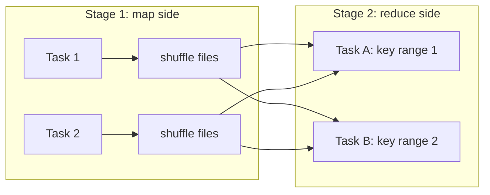
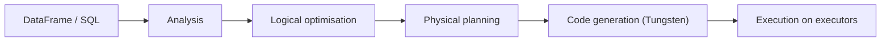

# Partitions, repartition and coalesce
id: pyspark-m07-partitions
track: pyspark

## What we're learning
A DataFrame is split into **partitions**: chunks of rows processed independently, one task per partition. The number of partitions sets the maximum parallelism of a stage.

Where partition counts come from:
- **Reading files**: roughly one partition per 128 MB of input (`spark.sql.files.maxPartitionBytes`), more for many small files.
- **After a shuffle**: `spark.sql.shuffle.partitions` (default 200), adjusted at runtime by Adaptive Query Execution.
- **Explicitly**: `repartition(n)` or `repartition(n, "col")` does a full shuffle to get evenly sized partitions, optionally grouped by a key. `coalesce(n)` merges existing partitions **without** a shuffle, so it can only reduce the count and may leave uneven sizes.

A common target is partitions of roughly 100 to 200 MB, and at least two to three times as many partitions as cores.

## Benefit
Too few partitions leave cores idle and make each task huge (risking spill or out-of-memory); too many create scheduling overhead and tiny output files. Getting this right is often the cheapest performance fix.

## Code snippet
```python
df.rdd.getNumPartitions()                 # inspect
df = df.repartition(64, "customer_id")    # shuffle into 64 partitions by key
df.coalesce(8).write.parquet("/out")      # fewer output files, no shuffle
```

## Limits and misconceptions
- `coalesce(1)` to produce one file forces the final stage onto one task; on large data that is slow and risky. Prefer table-format compaction.
- `coalesce` can reduce the parallelism of the work *before* it in the same stage, not just the write.
- `repartition` by a skewed key creates skewed partitions.

## Remember this
Partitions set parallelism; repartition shuffles to rebalance, coalesce merges cheaply but only downward.

## Related
pyspark-m07-shuffle, pyspark-m07-aqe, pyspark-m06-partitioning-bucketing, pyspark-m01-spark-architecture


# Shuffle
id: pyspark-m07-shuffle
track: pyspark

## What we're learning
A **shuffle** redistributes rows across partitions so that rows with the same key end up together. It happens for wide transformations: `groupBy`, `join` (unless broadcast), `distinct`, `orderBy`, `repartition`, and window functions with `partitionBy`.

Mechanically, each task in the upstream stage writes its rows into local **shuffle files**, one block per downstream partition. Tasks in the next stage then fetch their blocks from every upstream executor over the network. The shuffle is therefore the boundary between stages.

## Benefit
Understanding the shuffle explains most of Spark performance: it costs disk writes, network transfer, serialisation and sorting, and it is where skew and spill show up.

## Where it fits


## Limits and misconceptions
- Shuffles are not bad in themselves; they are how distributed aggregation and joins work. The aim is to avoid unnecessary ones and shrink necessary ones (filter and select columns first).
- The default of 200 shuffle partitions is wrong for both tiny and huge data. AQE adjusts it, but very large jobs may still need a higher starting value.
- Shuffle files live on executor local disks; losing an executor can force upstream recomputation unless an external shuffle service or decommissioning keeps them.

## Remember this
A shuffle moves rows by key across the network between stages; filter and project before it, and avoid the ones you do not need.

## Related
pyspark-m07-skew, pyspark-m07-aqe, pyspark-m07-broadcast-joins, pyspark-m01-dag-and-lineage


# Data skew
id: pyspark-m07-skew
track: pyspark

## What we're learning
**Skew** means some keys have far more rows than others. After a shuffle, all rows of one key go to one partition, so one task gets a huge partition while the others finish quickly. The stage takes as long as its slowest task.

How to spot it: in the Spark UI, a stage where the max task duration or shuffle read size is many times the median, or a job stuck at "199 of 200 tasks".

Typical causes: null or default keys (`-1`, `UNKNOWN`), a dominant customer or product, or time-based keys during a peak.

## Benefit
Fixing skew often turns hours into minutes, and it is a frequent cause of executor out-of-memory errors.

## Code snippet
```python
# 1. Let AQE split skewed join partitions (on by default with AQE in Spark 3.x)
spark.conf.set("spark.sql.adaptive.skewJoin.enabled", "true")

# 2. Handle null keys separately instead of joining them
nulls = facts.filter(F.col("customer_id").isNull())
joined = facts.filter(F.col("customer_id").isNotNull()).join(dim, "customer_id")

# 3. Salting an aggregation: spread a hot key over N sub-keys, then combine
salted = facts.withColumn("salt", (F.rand() * 16).cast("int"))
partial = salted.groupBy("product_id", "salt").agg(F.sum("qty").alias("q"))
total = partial.groupBy("product_id").agg(F.sum("q").alias("qty"))
```

## Limits and misconceptions
- AQE's skew join handling works for sort-merge joins, not for every operator (for example window functions or aggregations).
- Broadcasting the small side removes skew from a join entirely when the small side fits in memory.
- Salting adds complexity and an extra aggregation step; use it after the simpler fixes.

## Remember this
Skew is one key with too many rows; check nulls and hot keys, let AQE split joins, broadcast if possible, and salt as a last resort.

## Related
pyspark-m07-aqe, pyspark-m07-broadcast-joins, pyspark-m07-stages-tasks-scheduler, pyspark-m03-window-functions


# Caching and persistence
id: pyspark-m07-caching
track: pyspark

## What we're learning
Because every action re-runs the plan from the source, a DataFrame used several times is computed several times. `df.cache()` (or `persist(storageLevel)`) tells Spark to keep the result after the first computation:

- `MEMORY_AND_DISK` (the DataFrame default for `cache()`): keep partitions in memory, spill to disk if they do not fit.
- `MEMORY_ONLY`, `DISK_ONLY`, and replicated variants (`_2`).

Caching is lazy: data is stored when the first action runs. `unpersist()` releases it.

## Benefit
Caching pays off when an expensive intermediate result (a join of large tables, a parsed JSON source) is reused by several actions, or in iterative work such as ML training loops.

## Code snippet
```python
clean = raw.filter(...).join(dim, "id").cache()
clean.count()                                   # materialises the cache
clean.groupBy("region").count().write...        # reads from cache
clean.filter("status = 'ERR'").write...         # reads from cache
clean.unpersist()
```

## Limits and misconceptions
- Caching data used once only adds cost.
- Cached data competes with execution memory; over-caching causes spills and garbage collection pressure.
- A cache is per application and lost when the session ends. To share results between jobs, write a table.
- On some platforms (Databricks, for example) the disk cache of remote files works automatically and is different from `df.cache()`.
- Use `checkpoint()` or a written table, not `cache()`, to cut a very long lineage.

## Remember this
Cache only what you reuse, materialise it with an action, and unpersist when done.

## Related
pyspark-m01-lazy-evaluation, pyspark-m07-spill-memory-gc, pyspark-m01-dag-and-lineage


# Broadcast joins and join strategies
id: pyspark-m07-broadcast-joins
track: pyspark

## What we're learning
Spark picks a **physical join strategy** for each join:

- **Broadcast hash join**: the small side is collected and sent to every executor; each task joins its partition of the large side locally. **No shuffle of the large side.** Chosen automatically when Spark estimates the small side below `spark.sql.autoBroadcastJoinThreshold` (10 MB by default), or when hinted.
- **Sort-merge join**: both sides are shuffled by key and sorted, then merged. The default for two large tables; robust because it can spill to disk.
- **Shuffled hash join**: both sides shuffled, a hash table built on the smaller side per partition. Faster than sort-merge when one side's partitions fit in memory.
- **Broadcast nested loop** and **cartesian**: for non-equi joins and cross joins; expensive.

## Benefit
Most fact-to-dimension joins can be broadcast. Doing so removes the most expensive shuffle in many pipelines.

## Code snippet
```python
from pyspark.sql import functions as F
result = sales.join(F.broadcast(stores), "store_id")
result.explain()   # look for BroadcastHashJoin
```

## Limits and misconceptions
- Broadcast data must fit in driver and executor memory. A dimension of a few hundred MB can work; several GB usually cannot.
- Spark's size estimate can be wrong after filters or for uncompressed in-memory size. AQE re-checks actual sizes at runtime and can switch a sort-merge join to broadcast.
- A broadcast hint is ignored for join types that cannot broadcast the requested side (for example the left side of a left outer join).

## Remember this
Broadcast the small side to avoid shuffling the big one; sort-merge is the safe default for two large tables.

## Related
pyspark-m03-joins, pyspark-m05-hints, pyspark-m07-aqe, pyspark-m07-explain-plans


# Adaptive Query Execution
id: pyspark-m07-aqe
track: pyspark

## What we're learning
**Adaptive Query Execution (AQE)**, on by default since Spark 3.2, re-optimises a query **while it runs**, using real statistics collected at each shuffle boundary rather than estimates made before the start. Its main features:

- **Coalescing shuffle partitions**: merges many small post-shuffle partitions into fewer reasonable ones, so the 200-partition default matters less.
- **Switching join strategies**: converts a sort-merge join to a broadcast join when one side turns out small.
- **Skew join optimisation**: splits oversized partitions in a sort-merge join into smaller tasks.

## Benefit
AQE fixes many classic tuning problems automatically, which means fewer hand-tuned settings that go stale as data changes.

## Code snippet
```python
spark.conf.get("spark.sql.adaptive.enabled")                      # 'true'
spark.conf.set("spark.sql.adaptive.advisoryPartitionSizeInBytes", "128m")
```
In `explain()` output, an `AdaptiveSparkPlan` node and `isFinalPlan=true` after execution show AQE at work.

## Limits and misconceptions
- AQE acts only at shuffle boundaries; it cannot fix a bad scan or the first stage.
- It does not split skew in aggregations or window functions, only in joins.
- It cannot shrink data you did not need to read; pruning and filtering still matter.
- Streaming queries do not use AQE.

## Remember this
AQE re-plans at each shuffle using real sizes: it merges small partitions, switches to broadcast joins, and splits skewed join partitions.

## Related
pyspark-m07-skew, pyspark-m07-shuffle, pyspark-m07-broadcast-joins, pyspark-m07-catalyst-and-tungsten


# Catalyst optimiser and Tungsten engine
id: pyspark-m07-catalyst-and-tungsten
track: pyspark

## What we're learning
Every DataFrame or SQL query passes through **Catalyst**, Spark's optimiser, in four phases:

1. **Analysis**: resolve table and column names against the catalog into a resolved logical plan.
2. **Logical optimisation**: apply rules such as predicate pushdown, column pruning, constant folding and combining filters.
3. **Physical planning**: choose operators (which join strategy, which aggregation) using cost estimates.
4. **Code generation**: produce JVM bytecode.

**Tungsten** is the execution side: a compact binary row format stored off the JVM heap, cache-friendly algorithms, and **whole-stage code generation**, which fuses a chain of operators into one generated function so rows are not passed between operator objects.

## Benefit
This is why DataFrame code beats hand-written RDD code: Catalyst rewrites your query into a better plan, and Tungsten runs it close to the hardware. It is also why logic hidden in Python UDFs is slow: Catalyst cannot see into it.

## Where it fits


## Limits and misconceptions
- Catalyst's cost decisions depend on statistics. Without table statistics, size estimates can be badly wrong.
- Whole-stage code generation can be disabled for very wide or complex expressions; the plan shows which operators were fused (marked with `*(n)` in `explain` output).
- Vendor engines (Databricks Photon, Fabric's native execution engine) replace parts of Tungsten with native vectorised code but keep Catalyst planning.

## Remember this
Catalyst rewrites and plans the query, Tungsten executes it with compact memory and generated code.

## Related
pyspark-m07-explain-plans, pyspark-m01-rdd-vs-dataframe, databricks-m01-photon, fabric-m04-spark-performance-features


# Reading explain plans
id: pyspark-m07-explain-plans
track: pyspark

## What we're learning
`df.explain(mode)` prints the plan Spark will run. Modes: `simple` (physical plan), `extended` (all logical plans plus physical), `formatted` (a readable list of operators with details), `cost`, and `codegen`. The plan reads **bottom-up**: the scans are at the bottom, the final operator at the top.

What to look for:
- **Scan** nodes: `PushedFilters` and `PartitionFilters` show what was pushed to the source; `ReadSchema` shows which columns are read.
- **Exchange**: a shuffle. Count them and ask whether each is necessary.
- **Join type**: `BroadcastHashJoin` versus `SortMergeJoin`.
- **HashAggregate** pairs: a partial aggregate before the exchange and a final one after.
- `AdaptiveSparkPlan isFinalPlan=false` means AQE may still change things at runtime; the Spark UI shows the final plan.

## Benefit
Reading plans turns performance work from guessing into checking: you can see whether a filter reached the source or a join was broadcast before running a long job.

## Code snippet
```python
(orders.filter("order_date >= '2025-01-01'")
       .join(F.broadcast(stores), "store_id")
       .groupBy("region").agg(F.sum("amount"))
       .explain("formatted"))
```

## Limits and misconceptions
- The printed plan before execution is not always the plan that ran, because of AQE. Check the SQL tab of the Spark UI after the run.
- A filter missing from `PushedFilters` may still be applied after the scan; it just was not used to skip data.
- Plans for Python UDFs show `BatchEvalPython` or `ArrowEvalPython`: a sign data crosses into Python.

## Remember this
Read plans bottom-up and look at scans for pushed filters, Exchanges for shuffles, and join operators for the strategy.

## Related
pyspark-m07-catalyst-and-tungsten, pyspark-m07-pruning-and-pushdown, sql-m09-execution-plans, snowflake-m03-query-profile


# Partition pruning, column pruning and predicate pushdown
id: pyspark-m07-pruning-and-pushdown
track: pyspark

## What we're learning
The fastest data to process is data you never read. Spark has several ways to skip it:

- **Column pruning**: only the columns the query uses are read from columnar formats such as Parquet.
- **Predicate pushdown**: filters are passed to the reader, which uses Parquet row-group min/max statistics (or a database's WHERE clause for JDBC) to skip data.
- **Partition pruning**: a filter on a disk partition column (`event_date = '2025-10-15'`) means only matching folders are listed and read.
- **Dynamic partition pruning**: when a partitioned fact table is joined to a filtered dimension, Spark uses the dimension's surviving keys at runtime to prune fact partitions.
- **Data skipping** in table formats: Delta and Iceberg keep file-level statistics, so whole files are skipped, improved further by clustering or Z-ordering.

## Benefit
These mechanisms often reduce the data read by orders of magnitude, which cuts run time and cost more than any cluster tuning.

## Limits and misconceptions
- Wrapping a partition or filter column in a function (`to_date(event_ts) = ...`, `year(d) = 2025` on a non-partition column) can prevent pushdown. Filter on the stored column directly.
- Statistics only help if data is clustered: if every file contains every date, min/max cannot skip anything.
- Casting mismatches (comparing a string column to a number) can block pushdown.
- `select("*")` defeats column pruning.

## Remember this
Filter on stored columns, select only what you need, and lay data out so statistics can skip files.

## Related
pyspark-m06-partitioning-bucketing, pyspark-m08-delta-optimize-clustering, sql-m09-sargability, snowflake-m01-micro-partitions


# Memory, spill and garbage collection
id: pyspark-m07-spill-memory-gc
track: pyspark

## What we're learning
Each executor's JVM heap is divided by Spark's **unified memory manager** into:
- **Execution memory**: buffers for shuffles, joins, sorts and aggregations.
- **Storage memory**: cached data and broadcast variables. The two can borrow from each other.
- **User memory**: your own objects and Spark internals.

Outside the heap there is **memory overhead** for the JVM itself, native libraries and, in PySpark, the **Python worker processes** that run UDFs.

When execution memory runs out, Spark **spills** to local disk: slower but safe. When something cannot spill (a huge row, a giant `collect_list`, a broadcast that does not fit, Python worker memory), the executor fails with out-of-memory, or the container is killed by YARN or Kubernetes for exceeding its limit.

**Garbage collection (GC)** pauses appear when the heap is full of objects; long GC time in the Spark UI means memory pressure.

## Benefit
Knowing where memory goes lets you choose the right fix instead of blindly raising executor memory.

## Limits and misconceptions
- Spill in the Spark UI ("Spill (memory)", "Spill (disk)") is a warning, not an error, but heavy spill usually means partitions are too large.
- "Container killed by YARN for exceeding memory limits" usually means overhead (often Python) is too small, not the heap.
- Typical fixes, in order: more and smaller partitions, removing skew, avoiding `collect` and large broadcasts, reducing cached data, then more memory.
- Very large executors (lots of heap) can make GC pauses worse; moderate sizes are often better.

## Remember this
Spill means partitions are too big for execution memory; out-of-memory means something could not spill, often skew, collect, broadcast or Python.

## Related
pyspark-m10-resources-sizing, pyspark-m07-partitions, pyspark-m07-skew, pyspark-m07-caching


# Jobs, stages, tasks and the Spark UI
id: pyspark-m07-stages-tasks-scheduler
track: pyspark

## What we're learning
The vocabulary of Spark execution:

- **Job**: what one action triggers.
- **Stage**: a set of tasks that can run without a shuffle in between; jobs split into stages at shuffle boundaries.
- **Task**: one stage's work on one partition, run in one executor core (**slot**).

The **DAG scheduler** builds stages; the **task scheduler** assigns tasks to free slots, preferring executors close to the data. Failed tasks are retried (4 times by default) and slow tasks can be duplicated with **speculative execution**.

Shuffle files are written by executors. An **external shuffle service** (or, on Kubernetes, shuffle tracking and decommissioning) keeps them available when executors are removed by dynamic allocation.

The **Spark UI** shows all of this: the Jobs and Stages tabs (task durations, shuffle read and write, spill), the SQL tab (the executed plan with row counts per operator), Storage (cached data), Executors (memory, GC time, failed tasks), and Environment (settings).

## Benefit
The Spark UI is where most performance and failure investigations end. Knowing the job, stage and task model makes its pages readable.

## Limits and misconceptions
- The UI of a finished application is only available if event logs are kept and a history server (or the platform's equivalent) is running.
- Many stages are not a problem; a few stages with very long or very uneven tasks are.
- Task retries can hide flaky problems (bad nodes, external API timeouts) until they exhaust retries.

## Remember this
An action is a job, shuffles split it into stages, each stage runs one task per partition, and the Spark UI shows where time went.

## Related
pyspark-m01-dag-and-lineage, pyspark-m07-skew, pyspark-m12-logging-monitoring-debugging, pyspark-m10-dynamic-allocation
