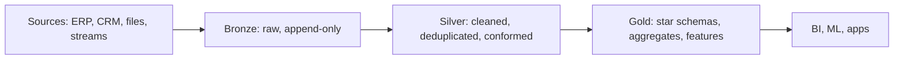

# Delta Lake: ACID tables on files
id: pyspark-m08-delta-lake
track: pyspark

## What we're learning
Plain Parquet folders have no transactions: a failed write leaves half-written files, readers can see partial results, and you cannot update a row. **Delta Lake** is an open-source **table format** that fixes this by adding a **transaction log** (the `_delta_log` folder) next to the Parquet data files.

Each write creates new Parquet files and then commits a JSON entry to the log listing which files were added and removed. Readers read the log to know which files make up the current version. Every few commits the log is summarised in a Parquet **checkpoint**.

This gives:
- **ACID transactions**: a write is all or nothing; concurrent writers are checked with optimistic concurrency.
- **Schema enforcement**: writes with the wrong columns or types are rejected.
- **Updates, deletes and MERGE** on files (rewriting affected files, or marking rows with deletion vectors).
- **Time travel**: read any retained earlier version.
- **File statistics** in the log for data skipping.

This is the **home lesson for Delta**; the Fabric and Databricks tracks describe their platform-specific features and link here.

## Benefit
Delta turns a data lake into something you can treat like database tables, which is the foundation of the lakehouse pattern and of Fabric and Databricks.

## Code snippet
```python
df.write.format("delta").mode("overwrite").saveAsTable("silver.orders")
spark.sql("DESCRIBE HISTORY silver.orders").show()        # one row per commit
spark.read.option("versionAsOf", 3).table("silver.orders")
```

## Limits and misconceptions
- Delta is not a database server. There are no indexes in the classic sense, and very high-frequency small writes create many small files and log entries.
- Concurrent writers to the **same files** conflict and one fails; design partitioning or clustering so concurrent jobs touch different data.
- Table features (deletion vectors, column mapping, liquid clustering) raise the protocol version; older readers may not be able to read the table.
- Delta's open-source project is Linux Foundation hosted; some features appear first on Databricks.

## Remember this
Delta adds a transaction log to Parquet files, giving ACID writes, schema enforcement, MERGE and time travel on a data lake.

## Related
tools-m03-open-table-formats, fabric-m02-delta-in-fabric, pyspark-m08-delta-merge, pyspark-m06-file-formats


# MERGE and upserts in Delta
id: pyspark-m08-delta-merge
track: pyspark

## What we're learning
`MERGE INTO` combines insert, update and delete in one atomic operation, driven by a join between a **source** (new or changed rows) and the **target** table:

- `WHEN MATCHED [AND condition] THEN UPDATE SET ...` or `DELETE`
- `WHEN NOT MATCHED THEN INSERT ...`
- `WHEN NOT MATCHED BY SOURCE THEN DELETE` (remove target rows missing from a full source snapshot)

It is the standard way to apply CDC feeds, upsert daily extracts, and maintain dimensions.

## Benefit
One transactional statement replaces fragile "delete then insert" logic, and reruns with the same source give the same result, which makes loads idempotent.

## Code snippet
```python
from delta.tables import DeltaTable

target = DeltaTable.forName(spark, "silver.customers")
(target.alias("t")
   .merge(updates.alias("s"), "t.customer_id = s.customer_id")
   .whenMatchedUpdateAll(condition="s.updated_at > t.updated_at")
   .whenNotMatchedInsertAll()
   .execute())
```
The SQL form is `MERGE INTO silver.customers t USING updates s ON ... WHEN MATCHED ...`.

## Limits and misconceptions
- **Duplicate keys in the source** make MERGE fail ("multiple source rows matched"). Deduplicate the source first.
- MERGE rewrites every file that contains a matched row. Without clustering or partitioning on the join key, a small update can rewrite most of the table. Add filters on the target (for example a date range) to the ON condition to limit the scan.
- Deletion vectors (where enabled) reduce rewrite cost by marking deleted rows instead of rewriting files.
- Schema evolution in MERGE needs explicit settings (`withSchemaEvolution()` or the session setting, depending on version).

## Remember this
MERGE applies inserts, updates and deletes atomically from a deduplicated source; limit the target files it touches.

## Related
sql-m08-merge-upsert, pyspark-m08-scd-patterns, pyspark-m03-deduplication, pyspark-m09-sinks-foreachbatch


# Time travel, restore and vacuum
id: pyspark-m08-delta-time-travel-vacuum
track: pyspark

## What we're learning
Because Delta never overwrites files in place, older versions of a table remain readable:

- **Time travel**: `SELECT * FROM t VERSION AS OF 12` or `TIMESTAMP AS OF '2025-10-01'`, or the `versionAsOf` reader option.
- **Restore**: `RESTORE TABLE t TO VERSION AS OF 12` makes an old version current again (as a new commit).
- **History**: `DESCRIBE HISTORY t` lists commits with operation, user and metrics.

Old files pile up, so **VACUUM** deletes data files no longer referenced by any version within the **retention period** (7 days by default). Log entries are cleaned separately according to `delta.logRetentionDuration` (30 days by default).

## Benefit
Time travel gives you an undo button for bad loads, reproducible reads for audits and ML training, and easy before-and-after comparisons during migrations.

## Code snippet
```python
spark.sql("DESCRIBE HISTORY silver.orders").select("version", "timestamp", "operation").show()
spark.sql("RESTORE TABLE silver.orders TO VERSION AS OF 41")
spark.sql("VACUUM silver.orders RETAIN 168 HOURS")
```

## Limits and misconceptions
- Time travel only reaches as far back as files survive. After VACUUM, versions older than the retention period are gone.
- Setting retention below 7 days is blocked by a safety check because it can break concurrent readers and streaming jobs.
- Time travel is not a backup: deleting the storage account or the table directory deletes all versions.
- Retaining long history costs storage, especially for tables rewritten often.

## Remember this
Delta keeps old versions until VACUUM removes files beyond the retention window; use time travel as undo, not as backup.

## Related
pyspark-m08-delta-lake, snowflake-m04-time-travel-fail-safe, sql-m06-temporal-tables


# Compaction, Z-order and liquid clustering
id: pyspark-m08-delta-optimize-clustering
track: pyspark

## What we're learning
Two layout problems slow down Delta tables:

1. **Small files**: streaming and frequent appends create thousands of tiny files. `OPTIMIZE table` compacts them into larger files (bin-packing), typically targeting around 1 GB.
2. **Poor clustering**: if every file contains a wide range of values for the filtered columns, file statistics cannot skip anything.

Ways to cluster data:
- **Partitioning** by a low-cardinality column (classic, coarse).
- **Z-ordering**: `OPTIMIZE t ZORDER BY (customer_id, event_date)` co-locates similar values across several columns, improving data skipping. It must be rerun as data arrives and rewrites a lot.
- **Liquid clustering**: declared on the table (`CLUSTER BY (col)`), it clusters incrementally during `OPTIMIZE`, and the clustering keys can be changed without rewriting the table. It is available in open-source Delta from version 3.1 and is Databricks' recommended layout for new tables; it cannot be combined with partitioning or Z-order on the same table.

## Benefit
Good layout lets queries skip most files, which is often a bigger win than more compute.

## Code snippet
```python
spark.sql("CREATE TABLE gold.events (id BIGINT, customer_id BIGINT, ts TIMESTAMP) USING DELTA CLUSTER BY (customer_id)")
spark.sql("OPTIMIZE gold.events")                              # compacts and clusters incrementally
spark.sql("OPTIMIZE silver.clicks ZORDER BY (user_id)")        # classic Z-order on another table
```

## Limits and misconceptions
- OPTIMIZE costs compute; schedule it rather than running it after every write. Platforms offer automation (auto compaction, optimised writes, Databricks predictive optimization).
- Clustering helps only queries that filter on the clustering columns.
- Choose clustering keys from real query filters, not guesses; two to four keys is typical.
- Feature support differs by engine and version (verify when reading Delta tables from other engines).

## Remember this
Compact small files with OPTIMIZE, and cluster on the columns you filter by, preferring liquid clustering for new tables.

## Related
databricks-m04-liquid-clustering, fabric-m02-delta-in-fabric, pyspark-m07-pruning-and-pushdown, snowflake-m03-clustering


# Schema enforcement and evolution
id: pyspark-m08-delta-schema-evolution
track: pyspark

## What we're learning
**Schema enforcement**: Delta rejects writes whose columns or types do not match the table, instead of silently corrupting it.

**Schema evolution** lets the schema change deliberately:
- **Adding columns**: write with `.option("mergeSchema", "true")`, or enable automatic evolution for MERGE. New columns are added at the end; old rows read them as null.
- **Type widening**: newer Delta versions can widen some types (for example int to long) without a rewrite (a table feature; verify support in your engine).
- **Renaming and dropping columns**: require **column mapping** (`delta.columnMapping.mode = 'name'`), which decouples logical names from Parquet column names.
- **Overwriting the schema**: `.option("overwriteSchema", "true")` with an overwrite replaces the table definition completely.

## Benefit
Sources change: an ERP upgrade adds fields, an API adds attributes. Controlled evolution lets pipelines absorb additive changes while still failing loudly on breaking ones.

## Code snippet
```python
(new_batch.write.format("delta")
          .mode("append")
          .option("mergeSchema", "true")     # accept new columns from the source
          .saveAsTable("bronze.erp_orders"))
```

## Limits and misconceptions
- Turning on `mergeSchema` everywhere means any typo in a column name becomes a new column. Allow evolution in bronze, be strict in silver and gold.
- Type changes that are not widening (string to int) need a rewrite.
- Enabling column mapping changes the table protocol; some older readers and engines cannot read it.

## Remember this
Delta enforces the schema by default; allow evolution deliberately, mostly in raw layers.

## Related
pyspark-m08-delta-lake, tools-m07-data-contracts, pyspark-m02-schema-and-types, tools-m02-schema-registry


# Change data feed
id: pyspark-m08-delta-change-data-feed
track: pyspark

## What we're learning
The **change data feed (CDF)** records row-level changes made to a Delta table. When enabled (`delta.enableChangeDataFeed = true`), each insert, update and delete is available to readers with extra columns:

- `_change_type`: `insert`, `update_preimage`, `update_postimage` or `delete`
- `_commit_version` and `_commit_timestamp`

You read changes between versions or timestamps in batch, or continuously as a stream with `readChangeFeed`.

## Benefit
Downstream tables (silver to gold, or a sync to an external system) can process only what changed instead of rescanning the whole table, and they can see deletes, which a "modified since" filter never shows.

## Code snippet
```python
spark.sql("ALTER TABLE silver.customers SET TBLPROPERTIES (delta.enableChangeDataFeed = true)")

changes = (spark.read.format("delta")
           .option("readChangeFeed", "true")
           .option("startingVersion", 120)
           .table("silver.customers"))
```

## Limits and misconceptions
- CDF only records changes after it is enabled.
- Change data is kept with the table and removed by VACUUM like other files, so consumers must keep up within the retention period.
- An update produces two rows (pre-image and post-image); consumers must filter to what they need.
- CDF describes changes inside the lakehouse. Capturing changes from source databases is a different job done by CDC tools or mirroring.

## Remember this
Change data feed exposes each row's insert, update and delete since a version, so downstream jobs process only changes, including deletes.

## Related
tools-m01-ingestion-styles, pyspark-m13-incremental-loads, snowflake-m02-streams-tasks, pyspark-m08-delta-merge


# Apache Iceberg and Apache Hudi
id: pyspark-m08-iceberg-hudi
track: pyspark

## What we're learning
Delta is one of three widely used open table formats. All three add metadata on top of Parquet files to provide transactions, schema evolution and time travel, but they come from different places:

- **Apache Iceberg** (from Netflix): metadata is a tree of metadata files, manifest lists and manifests, tracked through a **catalog** (Hive, AWS Glue, Nessie, REST catalogs such as Apache Polaris). Notable for **hidden partitioning** (partition by a transform such as `days(ts)` without users filtering on a separate column), partition evolution, and very broad engine support (Spark, Trino, Flink, Snowflake, BigQuery, Athena, DuckDB and others).
- **Apache Hudi** (from Uber): designed for frequent upserts and incremental processing, with **copy-on-write** and **merge-on-read** table types, built-in indexing and table services (compaction, clustering, cleaning).

From Spark, each is used through its own catalog and SQL extensions; reading and writing look similar to Delta.

## Benefit
Knowing all three matters because the choice is often made by the platform: Fabric and Databricks centre on Delta, Snowflake, AWS and many open engines centre on Iceberg, and some streaming-heavy stacks use Hudi.

## Limits and misconceptions
- The formats are converging: Delta UniForm writes Iceberg metadata, Fabric virtualises Delta as Iceberg, and Apache XTable translates between formats. Interoperability still has feature gaps.
- Iceberg needs a catalog to be managed safely; "Iceberg files in a folder" without a catalog lose most guarantees.
- Hudi's power comes with more knobs to tune.

## Remember this
Iceberg is the most engine-neutral format with catalog-based metadata, Hudi targets upsert-heavy pipelines, and Delta dominates Spark-centred platforms.

## Related
tools-m03-open-table-formats, tools-m03-format-interoperability, snowflake-m02-iceberg-tables, pyspark-m08-delta-lake


# Slowly changing dimensions in Spark
id: pyspark-m08-scd-patterns
track: pyspark

## What we're learning
A **slowly changing dimension (SCD)** is a dimension table (customer, product) whose attributes change over time. The main designs:

- **Type 1**: overwrite the attribute. No history. A simple MERGE update.
- **Type 2**: keep history by closing the old row (`valid_to`, `is_current = false`) and inserting a new row with a new surrogate key.
- **Type 3** and hybrids: keep a "previous value" column; rarely used.

With Delta, type 2 is usually one MERGE where the source contains each changed record **twice**: once with a null merge key to force an insert of the new version, and once with the real key to close the old row.

## Benefit
Type 2 lets facts be reported with the attributes valid at the time (the customer's region when the order was placed), which is often a legal or audit requirement.

## Code snippet
```python
changed = (src.alias("s").join(dim.filter("is_current").alias("d"), "customer_id")
              .filter("s.address <> d.address").select("s.*"))

staged = (changed.withColumn("merge_key", F.lit(None).cast("bigint"))      # rows to insert
          .unionByName(src.withColumn("merge_key", F.col("customer_id"))))  # rows to match

(DeltaTable.forName(spark, "gold.dim_customer").alias("d")
   .merge(staged.alias("s"), "d.customer_id = s.merge_key AND d.is_current")
   .whenMatchedUpdate(condition="d.address <> s.address",
                      set={"is_current": "false", "valid_to": "s.effective_date"})
   .whenNotMatchedInsert(values={"customer_id": "s.customer_id", "address": "s.address",
                                 "valid_from": "s.effective_date", "valid_to": "null",
                                 "is_current": "true"})
   .execute())
```

## Limits and misconceptions
- Compare only the attributes you track; comparing every column creates versions for irrelevant changes such as load timestamps.
- Handle nulls in comparisons with null-safe equality, or changes to and from null are missed.
- Late-arriving changes (an older effective date arriving after a newer one) need extra logic.
- Declarative pipeline tools on some platforms (for example Databricks' AUTO CDC) can generate SCD type 2 for you.

## Remember this
SCD type 1 overwrites, type 2 closes the old row and inserts a new one, and in Delta both are MERGE statements.

## Related
sql-m06-scd, pyspark-m08-delta-merge, pyspark-m02-nulls, databricks-m03-declarative-pipelines


# Medallion architecture
id: pyspark-m08-medallion
track: pyspark

## What we're learning
The **medallion architecture** organises lakehouse data into layers of increasing quality:

- **Bronze** (raw): data as received, append-only, with ingestion metadata (source file, load time). Used for replay and audit.
- **Silver** (cleaned, conformed): typed, deduplicated, validated, with consistent keys; often modelled per business entity. The integration layer.
- **Gold** (curated): business-level aggregates, star schemas and feature tables shaped for reports, ML and applications.

## Benefit
Layers give a shared vocabulary, a clear place for each kind of logic, and the ability to rebuild silver and gold from bronze when logic changes.

## Where it fits


## Limits and misconceptions
- It is a naming convention, not a standard. Three layers are not mandatory; some teams add a landing zone before bronze or a platinum or serving layer after gold, and simple pipelines may need only two.
- Copying full tables through every layer multiplies storage and compute. Use views or skip layers where they add nothing.
- The real work is in the contracts between layers: schemas, quality rules and ownership.
- Critics note that it says little about data modelling; you still need dimensional or other modelling for gold.

## Remember this
Bronze keeps raw history, silver cleans and conforms, gold serves the business; the value is in clear responsibilities, not the names.

## Related
databricks-m03-medallion-on-databricks, fabric-m02-lakehouse, pyspark-m11-validation-expectations, tools-m07-data-contracts
