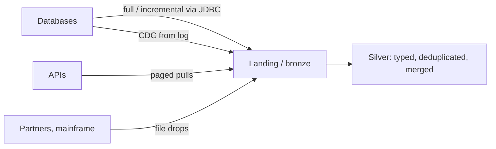
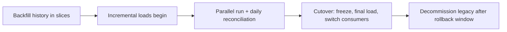

# Ingestion and extraction patterns
id: pyspark-m13-ingestion-patterns
track: pyspark

## What we're learning
Getting data out of source systems follows a few patterns:

- **Full extract**: copy the whole table every run. Simple and complete (it catches deletes), but expensive for large tables.
- **Incremental extract**: copy rows changed since the last run, using a reliable modified timestamp or increasing key. Cheap, but misses hard deletes.
- **Change data capture (CDC)**: read the database's transaction log (via Debezium, mirroring, Copy job CDC or vendor tools) to get every insert, update and delete in order.
- **Event or API ingestion**: pull from REST APIs with pagination and rate limits, or receive events from a broker.
- **File drops**: sources push files to a landing zone (SFTP, storage), and the platform picks them up.

A common landing design: raw data lands unchanged in a **landing or bronze zone** with metadata (source, extract time, batch ID), and all interpretation happens downstream.

## Benefit
Choosing the pattern per source, rather than one pattern for everything, balances freshness, source load, cost and completeness.

## Where it fits


## Limits and misconceptions
- "Last modified" columns are often unreliable (not updated by every code path, set in local time, not indexed). Validate them before trusting incremental loads.
- Pulling heavily from production OLTP databases during business hours causes incidents; agree windows and limits with source owners.
- Keeping raw history makes reprocessing possible but has storage and privacy costs.

## Remember this
Pick full, incremental, CDC, API or file ingestion per source, land data raw with metadata, and interpret it downstream.

## Related
tools-m01-ingestion-styles, pyspark-m13-incremental-loads, python-m06-rest-apis, pyspark-m08-medallion


# Reading Oracle and SQL Server via JDBC
id: pyspark-m13-jdbc-oracle-sqlserver
track: pyspark

## What we're learning
Migrations from legacy systems usually start with Spark reading **Oracle** and **SQL Server** over JDBC. Practical points:

- **Drivers**: Oracle's `ojdbc` jar and Microsoft's `mssql-jdbc` jar must be on the cluster. Managed platforms may include some drivers.
- **Partitioned reads**: use a numeric or date column with good spread (`partitionColumn`, bounds, `numPartitions`), or explicit predicates such as one per month. For Oracle tables without a good key, `ORA_HASH(ROWID, n)` predicates are a common trick.
- **Push work to the source**: pass a subquery in `dbtable` or use `query` to filter and project at the source.
- **Type mapping**: Oracle `NUMBER` without precision arrives as `DECIMAL(38,10)` or similar; `DATE` in Oracle contains a time; SQL Server `DATETIME` has about 3 ms precision; `NVARCHAR` and character sets need checking. Use `customSchema` to set Spark types explicitly.
- **Fetch size**: Oracle's default fetch size of 10 rows makes reads extremely slow; set `fetchsize` to thousands.

## Benefit
Getting these details right makes bulk extraction fast, avoids precision and timezone bugs, and keeps the source DBA on your side.

## Code snippet
```python
months = [f"ORDER_DATE >= DATE '2025-{m:02d}-01' AND ORDER_DATE < ADD_MONTHS(DATE '2025-{m:02d}-01', 1)"
          for m in range(1, 13)]
orders = spark.read.jdbc(
    url="jdbc:oracle:thin:@//erp-db:1521/ERPPDB",
    table="(SELECT ORDER_ID, CUSTOMER_ID, AMOUNT, ORDER_DATE FROM SALES.ORDERS) o",
    predicates=months,
    properties={"user": user, "password": pwd, "fetchsize": "10000",
                "driver": "oracle.jdbc.OracleDriver",
                "customSchema": "ORDER_ID DECIMAL(18,0), AMOUNT DECIMAL(18,2)"})
```

## Limits and misconceptions
- Partitioned JDBC reads are not a consistent snapshot. For a consistent cut, read from a snapshot, a standby or a flashback query (`AS OF SCN` in Oracle).
- Network and source throughput, not Spark, are usually the bottleneck.
- For very large or continuous replication, CDC tools or platform mirroring are better than repeated JDBC extracts.

## Remember this
Partition JDBC reads, push filters to the source, raise fetch size, and pin types explicitly when extracting from Oracle and SQL Server.

## Related
pyspark-m06-jdbc, sql-m12-dialect-translation, sql-m12-data-type-mapping, fabric-m02-mirroring


# Mainframe extracts and flat files
id: pyspark-m13-mainframe-flat-files
track: pyspark

## What we're learning
Legacy mainframe and midrange systems typically deliver **flat files**:

- **Fixed-width** records: each field at a fixed position and length, no delimiter. Read as text lines and slice with `substring`.
- **EBCDIC** encoding instead of ASCII or UTF-8.
- **COBOL copybooks** describing record layouts, including `REDEFINES` (alternative layouts), `OCCURS` (repeating groups) and multiple record types in one file.
- **Packed decimal (COMP-3)** and binary (COMP) numeric fields, which are not text at all.

For anything beyond simple fixed-width text, use a library that understands copybooks, such as the open-source **Cobrix** Spark data source, or have the mainframe side convert files to delimited UTF-8 before transfer.

## Benefit
Mainframe data is often the core of the business (policies, accounts, transactions). Reading it correctly, including signs and implied decimals, is a prerequisite for any migration.

## Code snippet
```python
# Simple fixed-width text already converted to ASCII
lines = spark.read.text("/landing/mainframe/CUSTMAST.txt")
customers = lines.select(
    F.trim(F.substring("value", 1, 10)).alias("customer_id"),
    F.trim(F.substring("value", 11, 40)).alias("name"),
    (F.substring("value", 51, 11).cast("decimal(11,0)") / 100).alias("balance"))  # implied 2 decimals

# EBCDIC with a copybook, using the Cobrix data source
df = (spark.read.format("cobol")
      .option("copybook", "/landing/mainframe/CUSTMAST.cpy")
      .load("/landing/mainframe/CUSTMAST.dat"))
```

## Limits and misconceptions
- Converting EBCDIC to ASCII in transit (for example in file transfer) corrupts packed decimal fields; transfer binary files in binary mode.
- Signs may be encoded in the last digit (overpunch), and decimals are often implied by the copybook (`PIC S9(9)V99`).
- Agree a file control record or trailer with record counts and totals, and reconcile against it.

## Remember this
Mainframe files need their copybook: fixed widths, EBCDIC, packed decimals and implied decimals must all be decoded deliberately.

## Related
pyspark-m06-file-formats, pyspark-m11-reconciliation, pyspark-m06-xml-and-excel


# Incremental loads and watermark columns
id: pyspark-m13-incremental-loads
track: pyspark

## What we're learning
An **incremental load** processes only data that is new or changed since the last successful run. The classic method is a **high-water mark**:

1. Store the last processed value of a reliable column (`modified_at`, an increasing ID, a SQL Server `rowversion`, an Oracle SCN) in a control table.
2. Extract rows greater than the stored value (minus a small overlap to catch late commits).
3. MERGE them into the target on the business key.
4. Update the stored watermark only after the target write succeeds.

Deletes need another mechanism: soft-delete flags in the source, periodic full key comparisons, or CDC.

## Benefit
Incremental loads cut run time and source load from hours to minutes for large tables, which makes frequent refreshes affordable.

## Code snippet
```python
last = spark.table("ctl.watermarks").filter("table_name = 'orders'").first()["last_value"]
new_rows = (read_source(f"SELECT * FROM dbo.Orders WHERE ModifiedAt > DATEADD(minute, -10, '{last}')"))

merge_into_silver(new_rows)                          # MERGE on OrderId: overlap rows just update
max_seen = new_rows.agg(F.max("ModifiedAt")).first()[0]
if max_seen:
    spark.sql(f"UPDATE ctl.watermarks SET last_value = '{max_seen}' WHERE table_name = 'orders'")
```

## Limits and misconceptions
- Long-running source transactions can commit rows with timestamps older than the watermark; the overlap window protects against this.
- Updating the watermark before the write succeeds loses data on failure.
- Tools such as Fabric Copy job, Databricks Lakeflow Connect and ADF handle watermark state for you; build your own only when needed.

## Remember this
Read past the stored high-water mark with an overlap, MERGE by key, and move the mark only after a successful write; handle deletes separately.

## Related
pyspark-m08-delta-merge, fabric-m03-copy-job, pyspark-m08-delta-change-data-feed, pyspark-m12-idempotency-retries


# Backfill and cutover
id: pyspark-m13-backfill-cutover
track: pyspark

## What we're learning
Moving a workload from a legacy system to a new platform has two data phases:

- **Backfill**: load history into the new platform. Usually a one-off bulk extract (or several, by year or month) followed by the incremental pipeline taking over from a defined point. Backfills run the same transformation code as daily runs, slice by slice, so they are repeatable.
- **Parallel run**: old and new run side by side for a period. Outputs are **reconciled** daily (counts, totals, checksums, key report figures) and differences are explained or fixed.
- **Cutover**: consumers switch to the new platform at a planned moment. Steps: freeze changes, final incremental load, final reconciliation, switch connections, monitor closely, keep the old system read-only for rollback for an agreed period.

## Benefit
A planned backfill and parallel run catch translation errors before users depend on the new numbers, and a rehearsed cutover makes the switch boring, which is the goal.

## Where it fits


## Limits and misconceptions
- Differences in parallel runs are often the old system's bugs. Decide with the business which behaviour is correct before "fixing" the new one.
- Backfills compete with production for capacity; schedule and size them.
- Reports, extracts and integrations that read the old system are easy to forget; lineage and access logs help find them.

## Remember this
Backfill history with the production code, run old and new in parallel with daily reconciliation, then cut over with a rehearsed plan and a rollback window.

## Related
pyspark-m11-reconciliation, fabric-m10-migrating-from-legacy, sql-m12-reconciliation, pyspark-m12-idempotency-retries
