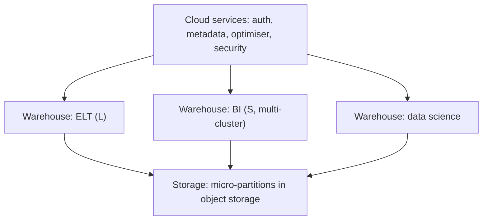

# Storage, compute and cloud services
id: snowflake-m01-three-layer-architecture
track: snowflake
verified: 2026-10

## What we're learning
Snowflake is a fully managed SaaS data platform built from three independent layers:

1. **Database storage**: data is reorganised into a compressed, columnar format in cloud object storage (on AWS, Azure or GCP), split into **micro-partitions**. You never see the files.
2. **Compute**: **virtual warehouses**, clusters that run queries. Many warehouses can read the same data at the same time without competing for resources.
3. **Cloud services**: the "brain": authentication, metadata, query parsing and optimisation, access control, transactions and result caching.

Because storage and compute are separate, you can run a small warehouse for BI and a large one for loading on the same tables, and pay for each separately.

## Benefit
Near-zero administration (no indexes, vacuuming or tuning of files in classic Snowflake tables), workload isolation, and elastic scaling make Snowflake easy to run for SQL-centric teams.

## Where it fits

## Limits and misconceptions
- Classic Snowflake tables use Snowflake's own storage format; other engines read them only through Snowflake (or by using Iceberg tables instead).
- Cloud services usage is billed only above 10 percent of daily warehouse compute, but metadata-heavy patterns can exceed that.
- "No tuning" is not "no design": clustering, warehouse sizing and query patterns still decide cost.

## Remember this
Snowflake separates storage, compute warehouses and a cloud services brain, so many workloads share data without competing.

## Related
tools-m04-warehouse-engines, snowflake-m01-virtual-warehouses, snowflake-m01-micro-partitions

# Virtual warehouses
id: snowflake-m01-virtual-warehouses
track: snowflake
verified: 2026-10

## What we're learning
A **virtual warehouse** is a named compute cluster. Sizes run from **X-Small** (1 credit per hour) doubling at each step up to **6X-Large** (512 credits per hour for standard Gen1 warehouses). Billing is **per second with a 60-second minimum** each time a warehouse starts. **Auto-suspend** stops it after idle time and **auto-resume** restarts it on the next query (both on by default).

Warehouse kinds (as of October 2026):
- **Standard warehouses**, in **Gen1** and the newer **Gen2** (GA since 2025, faster hardware and software, at a higher credit rate per hour; check which is the default in your region).
- **Snowpark-optimised** warehouses with much more memory per node for ML and large Python workloads.
- **Adaptive warehouses** (GA June 2026, Enterprise Edition): Snowflake sizes and scales automatically and bills per query, within limits you set.
- **Interactive warehouses** for low-latency serving queries.

## Benefit
Each team or workload gets its own right-sized compute that costs nothing when idle, and changing size is a single command.

## Limits and misconceptions
- A bigger warehouse makes a single large query faster (roughly halving time per size step for well-parallelised work) but does not help concurrency by itself; multi-cluster warehouses do.
- Very short auto-suspend settings can lose the local data cache and add restart overhead; very long ones waste credits.
- Gen2 is faster but costs more per hour; measure cost per workload before switching.

## Remember this
A virtual warehouse is per-second-billed compute that doubles in size and credits per step and suspends when idle.

## Related
snowflake-m03-warehouse-sizing-multicluster, snowflake-m01-credits, databricks-m05-sql-warehouses

# Micro-partitions
id: snowflake-m01-micro-partitions
track: snowflake
verified: 2026-10

## What we're learning
Snowflake automatically divides every table into **micro-partitions**: immutable, columnar storage units holding about 50 to 500 MB of uncompressed data, created in the order data is inserted or loaded. For each micro-partition and column, Snowflake stores **metadata**: minimum and maximum values, number of distinct values and other properties.

When a query filters (`WHERE order_date = '2025-10-15'`), the optimiser checks the metadata and **prunes** micro-partitions that cannot contain matching rows, before reading any data. Updates and deletes write new micro-partitions rather than changing existing ones, which is what makes Time Travel possible.

## Benefit
Pruning gives most of the benefit of partitioning and indexing without anyone defining partitions; tables loaded in date order are naturally well pruned on date.

## Limits and misconceptions
- Pruning works only if similar values are stored together. If a table is loaded in random order relative to the filter column, every micro-partition overlaps the filter and nothing is pruned; clustering keys fix this for very large tables.
- Predicates containing subqueries are not used for pruning, even if the subquery returns a constant.
- The Query Profile's "partitions scanned versus partitions total" shows whether pruning works.

## Remember this
Snowflake splits tables into small immutable micro-partitions with min and max metadata, and skips those that cannot match a filter.

## Related
snowflake-m03-clustering, pyspark-m07-pruning-and-pushdown, snowflake-m03-query-profile

# Editions
id: snowflake-m01-editions
track: snowflake
verified: 2026-10

## What we're learning
Snowflake is sold in editions; each includes everything in the one before:

- **Standard**: core platform, Time Travel up to 1 day, Fail-safe, secure data sharing.
- **Enterprise**: Time Travel up to 90 days, **multi-cluster warehouses**, materialized views, **search optimization**, **query acceleration**, **masking policies** and **row access policies**, aggregation and projection policies, periodic rekeying, adaptive warehouses.
- **Business Critical** (formerly "Enterprise for Sensitive Data"): Tri-Secret Secure (customer-managed keys), **private connectivity** (AWS PrivateLink, Azure Private Link, Google Private Service Connect), support for regulated data (HIPAA, PCI DSS), database failover and client redirect for business continuity.
- **Virtual Private Snowflake (VPS)**: a fully isolated Snowflake environment with dedicated metadata and compute.

Credit prices rise with the edition.

## Benefit
Knowing which features need which edition avoids designing a solution (masking policies, private networking, failover) that the account cannot use.

## Limits and misconceptions
- Many governance features that data teams assume are standard (masking, row access policies) need Enterprise.
- Private connectivity needs Business Critical, which matters for strict network policies.
- Higher editions raise the price of every credit, not only for the extra features.

## Remember this
Enterprise adds multi-cluster, long Time Travel and masking and row policies; Business Critical adds private connectivity, customer keys and failover.

## Related
snowflake-m01-credits, snowflake-m06-masking-policies, snowflake-m06-network-policies

# Credits and billing
id: snowflake-m01-credits
track: snowflake
verified: 2026-10

## What we're learning
Snowflake bills in **credits** (with a price per credit set by edition, region and contract) plus storage and data transfer:

- **Warehouse compute**: credits per hour by size, billed per second (60-second minimum per start).
- **Serverless features**: Snowpipe (since December 2025, a flat rate per GB ingested), Snowpipe Streaming, automatic clustering, search optimisation, materialized view maintenance, serverless tasks, query acceleration, replication and AI functions each consume credits.
- **Cloud services**: charged only for the part above 10 percent of the day's warehouse compute.
- **Storage**: average compressed terabytes per month, including Time Travel and Fail-safe data.
- **Data transfer**: egress across regions or clouds.

## Benefit
Pay-per-use with per-second billing means idle compute costs nothing, and each workload's cost is visible by warehouse.

## Limits and misconceptions
- Serverless features are easy to forget: automatic clustering on a heavily updated table or search optimisation on many columns can cost more than the warehouses.
- Long Time Travel retention on frequently rewritten tables multiplies storage.
- Comparing credits with Databricks DBUs or Fabric capacity units only makes sense for the same measured workload.

## Remember this
Snowflake bills credits for warehouses and serverless features, plus storage and egress; serverless features are the cost most often overlooked.

## Related
snowflake-m08-resource-monitors-cost, databricks-m07-dbu-cost-model, fabric-m01-licensing-capacity
