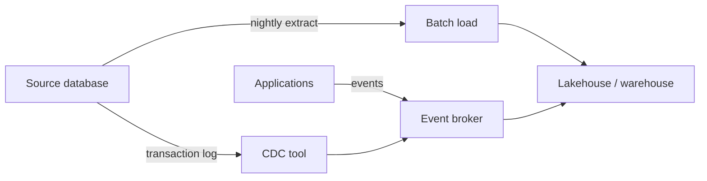

# Batch, CDC and streaming ingestion
id: tools-m01-ingestion-styles
track: tools
verified: 2026-10

## What we're learning
There are three basic ways to move data from source systems into an analytics platform:

- **Batch extraction**: copy a full table or the rows changed since a timestamp, on a schedule (hourly, nightly). Done with JDBC reads, ADF or Fabric copy activities, Copy job, managed connectors.
- **Change data capture (CDC)**: read the source database's transaction log (or its built-in change tables) and deliver every insert, update and delete in commit order, typically within seconds. Done with Debezium, Fabric mirroring, Copy job CDC, Databricks Lakeflow Connect, AWS DMS, GCP Datastream, Oracle GoldenGate and similar.
- **Event streaming**: applications publish events (an order was placed, a sensor reading) to a broker such as Kafka, Event Hubs or Kinesis, and consumers read them continuously.

CDC and streaming often meet: CDC tools frequently publish changes as events to Kafka.

## Benefit
The style sets freshness, cost, completeness and the load you put on the source. Choosing deliberately per source avoids both over-engineering (streaming a table that changes once a day) and stale data (nightly copies of something the business watches by the minute).

## Where it fits

## Compared with
| | Batch | CDC | Streaming events |
|---|---|---|---|
| Freshness | Hours | Seconds to minutes | Seconds |
| Sees deletes | Only with full copies | Yes | If modelled as events |
| Source impact | Heavy queries in a window | Light, reads the log | None (apps publish) |
| Complexity | Low | Medium (log access, ordering) | Medium to high |
| Typical tools | ADF, Copy job, JDBC | Debezium, mirroring, DMS | Kafka, Event Hubs, Kinesis |

## Limits and misconceptions
- CDC needs privileges and configuration on the source (log retention, supplemental logging, CDC enabled), which DBAs must approve.
- CDC gives row changes, not business events: an "order shipped" may appear as updates to three tables.
- Streaming does not make downstream analysis real time by itself; the whole pipeline must keep up.

## Remember this
Batch copies snapshots on a schedule, CDC copies every change from the log, and streaming carries events as they happen.

## Related
pyspark-m13-ingestion-patterns, tools-m01-debezium, fabric-m02-mirroring, pyspark-m09-streaming-model

# Debezium and log-based CDC
id: tools-m01-debezium
track: tools
verified: 2026-10

## What we're learning
**Debezium** is an open-source CDC platform (from Red Hat, Apache 2.0) that reads database change logs and emits one event per row change, with before and after values and source metadata. Stable connectors (version 3.x in 2026) cover **MySQL, MariaDB, PostgreSQL, SQL Server, Oracle, Db2, MongoDB and Cassandra**, with more incubating.

What each source must provide:
- **PostgreSQL**: logical replication (`wal_level=logical`), a replication slot and a publication.
- **MySQL and MariaDB**: the binary log in row format.
- **SQL Server**: CDC enabled on the database and tables, with SQL Server Agent running (Debezium reads the CDC change tables).
- **Oracle**: archive log mode and supplemental logging, read through LogMiner (default) or XStream (which needs a GoldenGate licence).

Deployment options: as **Kafka Connect** connectors (the classic setup, writing to Kafka topics), as **Debezium Server** (a standalone service that sends events to Kinesis, Pub/Sub, Event Hubs, Pulsar, Redis and others without Kafka), or embedded as a Java library. A connector first takes a consistent **snapshot** of existing data, then streams changes; incremental snapshots can be triggered later without stopping the stream.

## Benefit
Debezium gives low-latency, complete change streams (including deletes) with little load on the source and no vendor licence, which makes it a common backbone for event-driven architectures and lakehouse CDC.

## Limits and misconceptions
- You operate it: Kafka Connect or Debezium Server, offsets, schema history topics, upgrades and monitoring.
- On PostgreSQL, a stalled consumer keeps its replication slot from advancing, and the database keeps WAL until disk fills. Monitor slot lag.
- Delivery is at-least-once by default; consumers must handle duplicates (exactly-once support exists for Kafka Connect deployments in recent versions).
- Turning row events into analytical tables still needs a MERGE pipeline downstream.
- Managed alternatives (Fabric mirroring, Lakeflow Connect, Fivetran, AWS DMS, Datastream) trade control for less operation.

## Remember this
Debezium turns database logs into row-change events for Kafka or other targets, at the cost of running and monitoring it yourself.

## Related
tools-m02-kafka, tools-m01-ingestion-styles, fabric-m02-mirroring, pyspark-m08-delta-merge

# Managed connectors: Fivetran, Airbyte and similar
id: tools-m01-managed-connectors
track: tools
verified: 2026-10

## What we're learning
**Managed connector platforms** sell pre-built, maintained pipelines from hundreds of sources (SaaS apps such as Salesforce and Workday, databases, files, APIs) into warehouses and lakehouses. You configure credentials and a destination; the vendor handles API changes, schema drift, incremental sync and retries.

- **Fivetran**: fully managed SaaS, priced mainly on **monthly active rows (MAR)**, the distinct rows changed per month per connection, with 2026 changes adding a minimum per connection and counting deletes. Fivetran merged with **dbt Labs** (completed June 2026) and added reverse ETL by acquiring Census.
- **Airbyte**: an open-source core you can self-host, plus Airbyte Cloud with credit- or capacity-based plans. A large connector catalogue (700+ claimed), including community connectors, and a connector builder for custom APIs.
- Others: Stitch, Hevo, Matillion, and platform-native options such as Fabric Copy job and mirroring, Databricks Lakeflow Connect, Snowflake Openflow.

## Benefit
Buying connectors frees engineers from maintaining dozens of fragile API integrations, which is often the least valuable and most time-consuming part of a data platform.

## Limits and misconceptions
- Costs grow with data change volume; a noisy source (frequent updates, full refreshes) can be expensive. Model costs before connecting high-churn tables.
- Data passes through or is processed by a third party; check residency, security and compliance requirements.
- Connectors land data in the vendor's schema conventions; transformation is still your job (often dbt).
- Open-source connectors vary in quality; test the ones you need.

## Remember this
Managed connectors buy maintained ingestion from many sources; pay attention to row-based pricing and where data flows.

## Related
tools-m01-azure-data-factory, databricks-m03-ingestion-connectors, tools-m04-dbt, fabric-m03-copy-job

# Azure Data Factory
id: tools-m01-azure-data-factory
track: tools
verified: 2026-10

## What we're learning
**Azure Data Factory (ADF)** is Azure's cloud data integration and orchestration service. Pipelines contain activities (copy, data flow, notebook, stored procedure, web, control flow) and run on **integration runtimes (IRs)**:

- **Azure IR**: managed, serverless compute for cloud copies and data flows, optionally inside a managed virtual network.
- **Self-hosted IR**: Windows software inside your network for on-premises and private sources; outbound connections only.
- **Azure-SSIS IR**: managed machines that run existing SSIS packages, for lift-and-shift of SQL Server ETL.

**Mapping data flows** are visual transformations executed on managed Spark.

Microsoft now describes **Data Factory in Microsoft Fabric** as the next generation of ADF and points new users there. ADF remains supported with no announced deprecation, but new investment goes into Fabric.

## Benefit
ADF is a mature, widely deployed orchestrator and copy engine with many connectors, and the only Azure-native home for running SSIS packages unchanged.

## Compared with
| | Azure Data Factory | Fabric Data Factory |
|---|---|---|
| Delivery | Azure PaaS resource | Part of Fabric SaaS |
| Private sources | Self-hosted IR | On-premises or VNet data gateway |
| SSIS packages | Azure-SSIS IR | Not supported |
| Datasets | Separate objects | Inline in activities |
| Visual transforms | Mapping data flows (Spark) | Dataflow Gen2 (Power Query) |
| Billing | Per activity run, DIU-hours, data flow cores | Fabric capacity units |

## Limits and misconceptions
- ADF is an orchestrator and mover, not a transformation engine for heavy logic; mapping data flows are convenient but costly at scale compared with Spark or SQL.
- CI/CD uses ARM templates and needs care with IR names and parameters across environments.
- Choosing ADF for new work in a Microsoft shop now usually means asking why not Fabric pipelines; ADF still fits where Fabric is not adopted or SSIS is needed.

## Remember this
ADF is Azure's established pipeline and copy service with self-hosted and SSIS runtimes; Fabric Data Factory is its successor for new Fabric-based work.

## Related
fabric-m03-pipelines, tools-m05-adf-fabric-pipelines, fabric-m01-fabric-vs-synapse-adf-premium, tools-m05-scheduling-vs-orchestration
