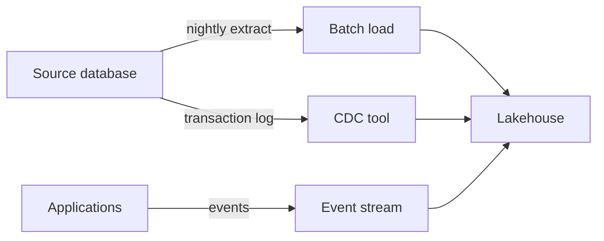

# Batch, CDC and streaming ingestion (sample)
id: tools-m01-ingestion-styles
track: tools
verified: pending

## What we're learning
There are three common ways to move data from source systems into an analytics platform: periodic batch copies, change data capture (CDC), and event streaming.

## Benefit
Choosing the right style sets the freshness, cost and load on the source system.

## Where it fits

## Remember this
Batch copies snapshots, CDC copies changes, streaming copies events.

## Related
fabric-m01-onelake, pyspark-m01-lazy-evaluation
