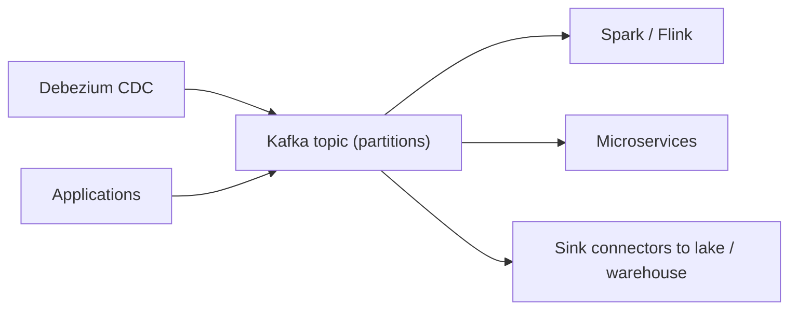

# Apache Kafka
id: tools-m02-kafka
track: tools
verified: 2026-10

## What we're learning
**Apache Kafka** is a distributed, durable **log** for events. Producers append records to **topics**; each topic is split into **partitions**, each an ordered, append-only log replicated across brokers. Consumers read at their own pace and track their position (**offset**). A **consumer group** shares a topic's partitions among its members, so adding consumers scales reading up to the number of partitions.

Records stay for a configured **retention** (time or size, 7 days by default) whether or not they were read, or indefinitely for **compacted** topics, which keep the latest value per key. Since **Kafka 4.0 (2025)** clusters run in **KRaft** mode only; ZooKeeper is gone. Kafka 4.2 made **share groups** ("queues for Kafka") production-ready for queue-style per-record acknowledgement, and tiered storage can move older segments to object storage.

Managed offerings include Confluent Cloud (Confluent was acquired by IBM in 2026), Amazon MSK, Aiven, Redpanda (Kafka-compatible) and Azure Event Hubs' Kafka endpoint.

## Benefit
Kafka decouples systems: producers do not know who consumes, consumers can replay history, and many independent consumers (a Spark job, a microservice, a search index) can read the same stream. It is the de facto backbone for CDC and event-driven architectures.

## Where it fits

## Limits and misconceptions
- Ordering is guaranteed only **within a partition**. Pick keys (customer ID, account ID) so related events share a partition.
- Partition count caps consumer parallelism and is hard to change later without reordering keys.
- Kafka is not a database or a query engine; it stores and delivers events. Analysis happens downstream.
- Running Kafka yourself is serious operations work; most teams should start with a managed service.

## Remember this
Kafka is a replicated, partitioned, replayable log; order holds within a partition and consumer groups scale reading.

## Related
pyspark-m09-kafka-eventhubs-kinesis, tools-m02-schema-registry, tools-m01-debezium, tools-m02-event-hubs

# Azure Event Hubs
id: tools-m02-event-hubs
track: tools
verified: 2026-10

## What we're learning
**Azure Event Hubs** is Azure's managed event ingestion service, with the same core model as Kafka: event hubs (topics) with partitions, consumer groups and retention. It offers a **Kafka-compatible endpoint** on the Standard tier and above, so Kafka clients and Spark's Kafka source can connect by changing configuration.

Tiers (limits as of 2026):
- **Basic**: 1 day retention, one consumer group; no Kafka endpoint.
- **Standard**: up to 7 days retention, Kafka endpoint, Schema Registry; scaled in throughput units (each about 1 MB/s in).
- **Premium**: up to 90 days retention, isolated resources, more partitions, geo-replication, customer-managed keys.
- **Dedicated**: single-tenant clusters for the largest workloads.

**Capture** writes incoming events automatically to Blob Storage or ADLS in Avro files on a time or size window.

## Benefit
No brokers to operate, tight integration with Azure identity, networking, Stream Analytics, Fabric Eventstreams and Azure Functions, and Kafka compatibility for existing clients.

## Compared with
| | Event Hubs | Self-run or managed Kafka |
|---|---|---|
| Operations | Fully managed | You or the vendor run brokers |
| Kafka compatibility | Protocol endpoint, not real Kafka | Native |
| Retention | 1 to 90 days by tier | Configurable, including tiered and infinite |
| Kafka ecosystem (Connect, Streams) | Partial | Full |

## Limits and misconceptions
- It speaks the Kafka protocol but is not Kafka: some features (for example certain admin APIs and Kafka Streams patterns) differ. Test your clients.
- On Basic and Standard the partition count is fixed at creation.
- Throughput is bought per unit; under-provisioning causes throttling.

## Remember this
Event Hubs is Azure's managed event log with a Kafka-compatible endpoint, sized by tier and throughput units.

## Related
tools-m02-kafka, fabric-m05-eventstreams, pyspark-m09-kafka-eventhubs-kinesis, tools-m11-cloud-map-ingest-store

# Amazon Kinesis
id: tools-m02-kinesis
track: tools
verified: 2026-10

## What we're learning
AWS's streaming family:

- **Kinesis Data Streams**: a managed, partitioned stream. Capacity is either **provisioned** in **shards** (each about 1 MB/s or 1,000 records/s in and 2 MB/s out) or **on-demand**, where AWS scales automatically (with a newer on-demand Advantage option for large steady workloads). Retention is 24 hours by default, up to 365 days. **Enhanced fan-out** gives each consumer its own read throughput.
- **Amazon Data Firehose** (renamed from Kinesis Data Firehose in 2024): managed delivery that buffers events and writes them to S3, Redshift, OpenSearch, Snowflake, Iceberg tables, Splunk or HTTP endpoints, with optional conversion to Parquet.
- **Amazon Managed Service for Apache Flink** (formerly Kinesis Data Analytics): managed Flink for processing streams.
- **Amazon MSK** is AWS's managed Kafka, an alternative to Kinesis Data Streams.

## Benefit
Serverless-feeling streaming inside AWS with IAM security and native links to Lambda, S3 and analytics services; Firehose in particular turns "stream to data lake" into configuration.

## Limits and misconceptions
- A single hot partition key is limited to one shard's throughput in every mode.
- The Kinesis API is not Kafka; moving between them means changing clients.
- Firehose buffers (seconds to minutes) and is delivery, not transformation; complex logic belongs in Flink or Spark.

## Remember this
Kinesis Data Streams is AWS's shard-based event stream, Firehose delivers streams to storage, and managed Flink processes them.

## Related
tools-m02-kafka, pyspark-m09-kafka-eventhubs-kinesis, tools-m02-flink-vs-spark-streaming

# Apache Pulsar
id: tools-m02-pulsar
track: tools
verified: 2026-10

## What we're learning
**Apache Pulsar** is a messaging and streaming platform that separates **serving** from **storage**: stateless **brokers** handle clients, while data is stored in **Apache BookKeeper** nodes as segments. Brokers can be added or replaced without moving data, and storage scales independently. Older data can be tiered to object storage.

Distinctive features:
- **Multi-tenancy** built in: tenant, then namespace, then topic, with policies and quotas at each level.
- **Geo-replication** between clusters as a built-in feature.
- **Queuing and streaming** in one system through subscription types (exclusive, failover, shared, key-shared).
- Pulsar Functions for lightweight processing and Pulsar IO connectors.

StreamNative is the main commercial vendor. Version 4.0 is the long-term support line.

## Benefit
Pulsar suits organisations offering messaging as a shared internal platform to many teams, and those needing native multi-region replication or both queue and stream semantics in one system.

## Compared with
| | Pulsar | Kafka |
|---|---|---|
| Storage | Separate (BookKeeper) | On brokers (plus tiered storage) |
| Multi-tenancy | Native | Via conventions and ACLs |
| Queue semantics | Native subscription types | Share groups since 4.2 |
| Ecosystem and talent | Smaller | Very large |

## Limits and misconceptions
- More moving parts (brokers, bookies, metadata store) make self-hosting harder.
- The ecosystem of connectors, tools and engineers is much smaller than Kafka's; Kafka-protocol compatibility layers exist to bridge this.
- Many of Pulsar's former advantages (tiered storage, queues, ZooKeeper removal) now exist in Kafka too.

## Remember this
Pulsar separates brokers from BookKeeper storage and adds native multi-tenancy and geo-replication, but has a smaller ecosystem than Kafka.

## Related
tools-m02-kafka, tools-m02-event-hubs

# Apache Flink vs Spark Structured Streaming
id: tools-m02-flink-vs-spark-streaming
track: tools
verified: 2026-10

## What we're learning
Both are distributed stream processors with event-time windows, watermarks, state and exactly-once checkpoints, but they come from different designs:

- **Apache Flink** processes **record by record** as a true streaming engine, with batch as a special case. It has rich state handling (RocksDB and, since Flink 2.0, disaggregated state stored remotely), timers, savepoints for upgrades, and **Flink SQL** for streaming SQL. Flink 2.x is current (2.3 in mid-2026), with 1.20 as the LTS line. Managed options include Amazon Managed Service for Apache Flink and Confluent's Flink offering.
- **Spark Structured Streaming** processes **micro-batches** by default, using the same DataFrame API and engine as batch. Spark 4.1 added a **real-time mode** for millisecond latency on stateless queries, and Spark 4.0 added a richer stateful API (`transformWithState`).

## Benefit
Choosing the right engine avoids running two platforms unnecessarily, or forcing millisecond requirements onto a micro-batch engine.

## Compared with
| | Flink | Spark Structured Streaming |
|---|---|---|
| Model | Per record | Micro-batch (plus real-time mode for stateless) |
| Typical latency | Milliseconds | Sub-second to minutes |
| Complex state, timers | Very strong | Good (improved in 4.x) |
| Batch and ML in same stack | Possible, less common | Native, same code base |
| Lakehouse integration | Good (Iceberg, Paimon, Delta connector) | Excellent with Delta on Databricks and Fabric |

## Limits and misconceptions
- Most analytics pipelines do not need millisecond latency; micro-batches of seconds or minutes are cheaper and simpler.
- If your team and platform already run Spark, Structured Streaming is usually the pragmatic default; Flink fits when latency, complex event processing or very large state dominate.
- Both need checkpoint storage, monitoring and careful upgrade handling.

## Remember this
Choose Flink for millisecond, stateful event processing; choose Spark Structured Streaming when micro-batch latency is enough and you want one engine for batch and streaming.

## Related
pyspark-m09-streaming-model, pyspark-m09-stateful-operations, pyspark-m09-triggers-output-modes, tools-m02-kinesis

# Schema registries
id: tools-m02-schema-registry
track: tools
verified: 2026-10

## What we're learning
A **schema registry** stores versioned schemas for the messages on a stream. Producers register a schema and send a small schema ID with each message; consumers fetch the schema to decode it. Formats are usually **Avro**, **Protobuf** or **JSON Schema**.

The registry enforces **compatibility rules** when a new version is registered:
- **Backward** (the common default): new consumers can read old data, for example adding an optional field. Upgrade consumers first.
- **Forward**: old consumers can read new data. Upgrade producers first.
- **Full**: both directions.
- **Transitive** variants check against all previous versions, not just the latest.

Main products: **Confluent Schema Registry** (Confluent Community License), **Apicurio Registry** (open source, Red Hat-led), **AWS Glue Schema Registry**, and **Azure Schema Registry** in Event Hubs (compatibility checks apply to Avro only).

## Benefit
A registry stops a producer from silently breaking every consumer with an incompatible change, and documents what is on each topic. It is the streaming equivalent of a table schema and a practical tool for data contracts.

## Limits and misconceptions
- Compatibility checks catch structural breaks, not semantic ones (a field that changes meaning from cents to euros).
- A registry only helps if producers are required to use it; enforce it in client configuration or broker policies.
- Different registries use different wire formats and APIs; switching is not free.

## Remember this
A schema registry versions message schemas and rejects incompatible changes before they break consumers.

## Related
tools-m07-data-contracts, tools-m02-kafka, pyspark-m08-delta-schema-evolution
