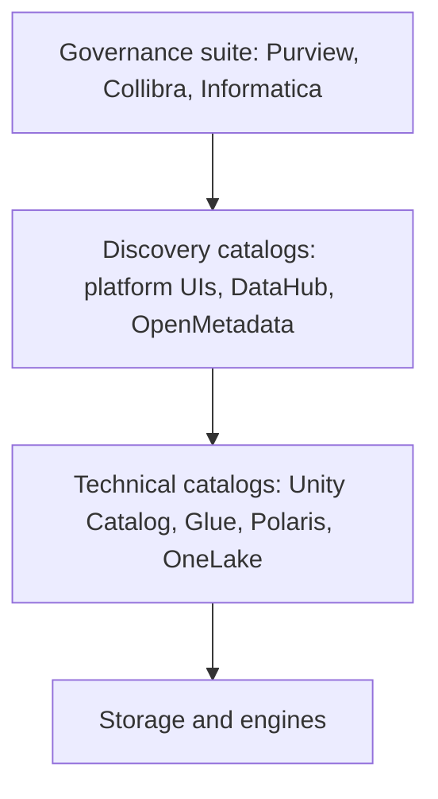

# Technical, business and enterprise data catalogs
id: tools-m06-catalogs-explained
track: tools
verified: 2026-10

## What we're learning
"Catalog" means three different things, and confusing them causes bad tool decisions:

1. **Technical catalog (metastore)**: the system an engine uses to resolve `schema.table` to files, schema and format, and to enforce permissions. Examples: Hive metastore, AWS Glue Data Catalog, Unity Catalog, Iceberg REST catalogs such as Apache Polaris, OneLake's item metadata. Without it, engines cannot find tables.
2. **Discovery or business catalog**: a searchable inventory for people, with descriptions, owners, glossary terms, tags, lineage, popularity and endorsement. Examples: OneLake catalog, Databricks Catalog Explorer, DataHub, OpenMetadata, Alation.
3. **Governance suite**: policy, classification, data quality, stewardship workflows and compliance across many platforms. Examples: Microsoft Purview, Collibra, Informatica, Atlan.

Modern platform catalogs (Unity Catalog, Fabric's OneLake catalog, Snowflake Horizon) blend levels 1 and 2 for their own platform. Enterprise tools aim at level 2 and 3 across all platforms.

## Benefit
Knowing the layers prevents expecting a governance suite to enforce query permissions, or expecting a metastore to give business users a glossary.

## Where it fits

## Limits and misconceptions
- A catalog full of auto-scanned tables with no owners or descriptions is a phone book nobody reads. Curation is the expensive part.
- Enterprise catalogs usually read metadata from platform catalogs; they rarely enforce access inside the engines.
- More catalogs mean more synchronisation. Decide which one is the source of truth for each kind of metadata.

## Remember this
Technical catalogs let engines find and secure tables, discovery catalogs help people find data, and governance suites manage policy across platforms.

## Related
pyspark-m05-catalog-tables, tools-m06-unity-catalog, tools-m06-purview, fabric-m08-purview-integration

# Unity Catalog in the landscape
id: tools-m06-unity-catalog
track: tools
verified: 2026-10

## What we're learning
**Unity Catalog** exists in two forms:

- **Databricks Unity Catalog**: the governance layer of the Databricks platform. It manages a three-level namespace (catalog, schema, table), permissions, row filters and column masks, attribute-based policies with tags, automatic table and column lineage, audit and billing system tables, data sharing, and governance of files, models, functions and secrets. It is deeply integrated with Databricks compute.
- **Unity Catalog open source**: a project Databricks donated to the LF AI & Data Foundation in 2024 (still a sandbox project, pre-1.0 at v0.7 in October 2026). It provides a catalog server for Delta and Iceberg tables, volumes, functions and models, with an Iceberg REST interface and Hive metastore compatibility, usable by Spark, DuckDB, Trino and others.

The open-source version is a **subset**: fine-grained policies, automatic lineage and system tables are Databricks features.

## Benefit
Unity Catalog gives one place to govern tables, files and AI assets on Databricks, and its open APIs (Iceberg REST, Delta) let other engines read governed tables.

## Limits and misconceptions
- Do not assume open-source Unity Catalog equals the Databricks product; check which features you need.
- Outside Databricks, governance is enforced only by engines that integrate with it.
- Organisations using several platforms still need a cross-platform view (Purview, Collibra, DataHub) or federation between catalogs.

## Remember this
Databricks Unity Catalog is a full governance layer on Databricks; the open-source Unity Catalog is a smaller, engine-neutral catalog server.

## Related
databricks-m02-unity-catalog-overview, tools-m06-catalogs-explained, tools-m03-format-interoperability

# Microsoft Purview
id: tools-m06-purview
track: tools
verified: 2026-10

## What we're learning
**Microsoft Purview** is Microsoft's family of data governance, security and compliance products. For data teams the key parts are:

- **Data Map**: scans sources (Azure SQL, ADLS, Fabric, Power BI, SQL Server on-premises, Amazon S3, Snowflake, Databricks, BigQuery and more) to collect metadata, classification and lineage. Private sources need a self-hosted integration runtime.
- **Unified Catalog**: business governance on top of the Data Map, with **governance domains**, **data products**, critical data elements, a glossary, **data quality** rules and **health** management.
- **Information Protection** (sensitivity labels), **Data Loss Prevention** and **Audit**: the compliance side shared with Microsoft 365, which Fabric uses for labels, DLP and audit logs.

Pricing for Unified Catalog (since 2025) is pay-as-you-go: per **governed asset** (assets linked to a data product or similar) per day and per processing unit for data quality and health work; scanned-only assets are not charged.

## Benefit
One governance plane across Microsoft and non-Microsoft sources, connected to the same sensitivity labels and compliance tools used for email and documents, which suits regulated organisations already standardised on Microsoft.

## Limits and misconceptions
- Purview catalogs and classifies; it does not enforce query permissions inside Snowflake, Databricks or Fabric engines (policy features exist for some sources, with limits).
- Scan depth varies by source; for Fabric items, metadata is mostly item-level.
- Value depends on curation: domains, owners, glossary terms and data products need people.
- Several products share the Purview name with different licences (Microsoft 365 E5 compliance versus data governance billing); clarify which one is meant.

## Remember this
Purview maps and classifies data across the estate, adds business governance with data products and quality, and supplies the labels, DLP and audit that Fabric uses.

## Related
fabric-m08-purview-integration, fabric-m08-sensitivity-labels, tools-m06-catalogs-explained, tools-m06-enterprise-catalogs

# DataHub and OpenMetadata
id: tools-m06-datahub-openmetadata
track: tools
verified: 2026-10

## What we're learning
Two leading **open-source metadata platforms** for discovery, lineage and governance across many tools:

- **DataHub** (created at LinkedIn, now under LF AI & Data; 1.x releases): an event-driven architecture where metadata changes flow through Kafka into a metadata service, with search on Elasticsearch or OpenSearch and a GraphQL API. Ingestion connectors pull from warehouses, BI tools, orchestrators and streaming systems; OpenLineage events and a Spark lineage plugin are supported. **DataHub Cloud** (from the company formerly called Acryl Data) adds observability, governance workflows and AI features.
- **OpenMetadata** (1.x releases, with a 2.0 line emerging): a schema-first design with a single server and a relational database plus search; built-in data quality tests, glossary, collaboration (conversations, tasks) and many connectors. **Collate** is the commercial managed version.

## Benefit
Both give a vendor-neutral catalog across Snowflake, Databricks, Fabric, Power BI, Airflow, dbt, Kafka and more, without an enterprise suite's licence cost.

## Compared with
| | DataHub | OpenMetadata |
|---|---|---|
| Architecture | Event streaming (Kafka) core | Single server, simpler to run |
| Strength | Large, real-time metadata estates; extensibility | Ease of deployment; built-in data quality and collaboration |
| Managed version | DataHub Cloud | Collate |

## Limits and misconceptions
- Running either yourself is real platform work (upgrades, scaling, connectors).
- Like all catalogs, adoption depends on curation and integration into daily work.
- They complement platform catalogs; they do not replace engine-level permissions.

## Remember this
DataHub and OpenMetadata are open-source, cross-platform catalogs; DataHub is event-driven and extensible, OpenMetadata simpler with built-in quality features.

## Related
tools-m06-catalogs-explained, tools-m06-lineage, tools-m07-data-observability

# Data lineage and OpenLineage
id: tools-m06-lineage
track: tools
verified: 2026-10

## What we're learning
**Lineage** records how data flows: which jobs read which datasets and wrote which others, and ideally which columns came from which. It is captured in three main ways:

- **Engine-native**: the platform observes queries it runs (Unity Catalog's table and column lineage, Fabric's item lineage, Snowflake's lineage in Horizon).
- **Parsing**: tools parse SQL, dbt projects or ETL definitions to infer lineage.
- **Instrumentation with OpenLineage**: an open standard (LF AI & Data) defining **run events** (start, complete, fail) that describe a job, a run, input and output datasets, and optional facets such as schema and column lineage. Integrations exist for Spark, Airflow (a built-in provider), dbt, Flink and others. **Marquez** is the reference backend; DataHub, Purview (via Event Hubs, preview), Google Dataplex, Atlan and others can receive OpenLineage events.

## Benefit
Lineage enables impact analysis before changes, root-cause analysis when numbers break, and compliance answers about where personal data travels.

## Limits and misconceptions
- No single method sees everything: engine-native lineage stops at the platform boundary, parsing misses dynamic code, instrumentation needs every tool to be integrated.
- Column-level lineage is much harder than table-level and often incomplete.
- Lineage without ownership metadata tells you what will break but not whom to tell.

## Remember this
Lineage comes from engines, parsing or OpenLineage events; combine them to see flows across platforms.

## Related
pyspark-m11-data-lineage, fabric-m08-lineage-impact, databricks-m02-lineage, tools-m06-datahub-openmetadata

# Enterprise catalogs: Collibra, Alation, Informatica
id: tools-m06-enterprise-catalogs
track: tools
verified: 2026-10

## What we're learning
Commercial governance and catalog platforms aimed at large, multi-platform organisations:

- **Collibra**: governance-led, with strong stewardship workflows, business glossary, policy management and data quality; in 2025 it added data access governance through an acquisition, positioning itself for "data and AI governance".
- **Alation**: search- and adoption-led, with a behavioural catalog that learns from query logs which data is used and trusted; it has added agentic AI capabilities.
- **Informatica**: a full data management suite (Intelligent Data Management Cloud) covering integration, data quality, master data management and a governance catalog, with the CLAIRE AI engine. **Salesforce completed its acquisition of Informatica in November 2025**, so its roadmap is now tied to Salesforce's data platform.
- Others in the space include Atlan and platform suites such as Microsoft Purview.

## Benefit
These tools serve organisations where governance is a formal function (regulators, data owners, stewards) spanning many platforms and old systems, needing workflows, approvals and auditability beyond what platform catalogs offer.

## Limits and misconceptions
- They are expensive and slow to implement; success depends on the operating model (owners, stewards, processes) more than on the tool.
- They mostly read metadata and coordinate people; enforcement still happens in the data platforms.
- Overlap with platform catalogs (Unity Catalog, OneLake catalog, Horizon) keeps growing; define which layer does what.

## Remember this
Collibra, Alation and Informatica are cross-platform governance suites for formal governance programmes; their value depends on the people and processes behind them.

## Related
tools-m06-catalogs-explained, tools-m06-purview, tools-m06-datahub-openmetadata
